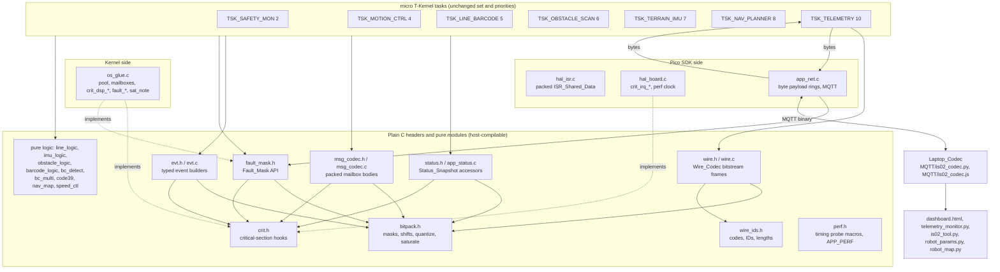
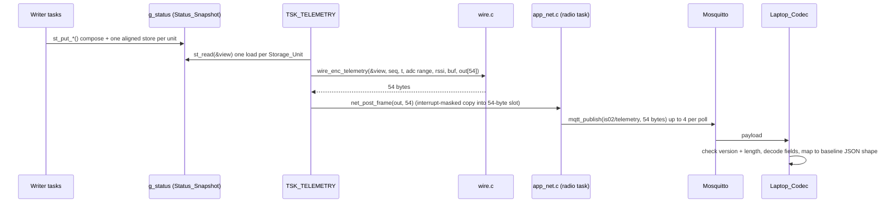
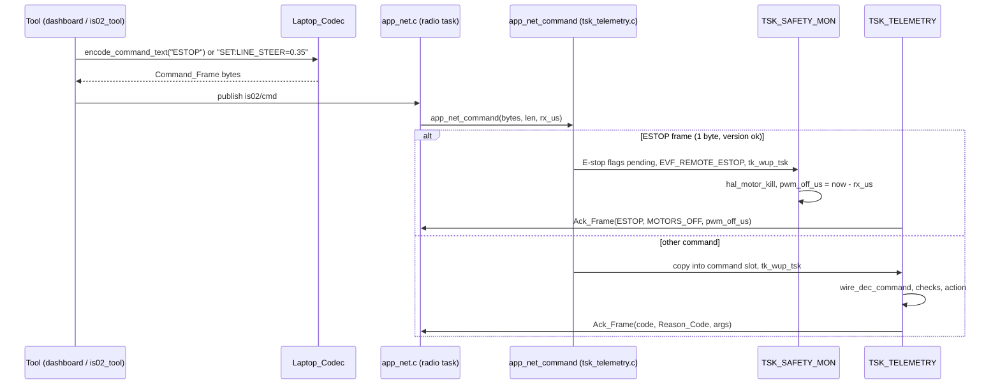

# Design Document: Minimum-Bit Data Representation

## Overview

This design implements Change Requirement 1 (minimum-bit data representation) for the IS-02 firmware in `app_program/` and the laptop tools in `MQTT/`. It keeps the seven tasks, their priorities, the kernel objects, the module boundaries and the MQTT topic names. It changes how data is stored and exchanged:

- Every Application_Field that is not a Private_Control_Variable is stored as a Packed_Field of exactly its Required_Bits, inside explicitly declared 8, 16 or 32-bit Storage_Units, written and read only through accessor functions in plain C headers.
- All fault and loss conditions live in one 16-bit Fault_Mask.
- Mailbox messages are packed, so the message pool block shrinks from 96 to 32 bytes.
- Every MQTT payload in both directions becomes a binary frame produced by one Wire_Codec (C, firmware side) and one Laptop_Codec (Python and JavaScript, laptop side), all three tested against one shared vector set.
- Lightweight timing probes, a PC host test suite, evidence scripts and documentation templates are added so the Week 13 evidence can be produced.

### Fixed decisions (accepted by the user)

| # | Decision | Where it shows up in this design |
|---|---|---|
| D1 | Private control variables (PI integrators, filter states, `g_prof`/`g_fine`/`g_view`, `wheel_ctl_t` internals) stay float32/int32 with documented reasons | Data Models, section "Private_Control_Variables" |
| D2 | All MQTT payloads become binary, including `BC_DBG` and `FINE_SCAN`; laptop tools get a shared Python codec and a JavaScript codec | Wire_Codec, Laptop_Codec, Event catalog |
| D3 | `robot_params.txt` stays `NAME=VALUE` text; tools convert names to Parameter_IDs | Laptop tool changes, Config_Frame |
| D4 | Legacy text commands available behind a build switch, off by default | Build switches (`APP_LEGACY_TEXT_CMD`) |
| D5 | Telemetry frame ≤ 25 % of baseline JSON size; ISR time ≤ 110 % of baseline; static RAM not increased; turn rate range ±720 °/s | Frame layouts (54-byte frame), ISR changes, RAM budget |
| D6 | Hardware measurements are done by the user; the code adds timing probes and scripts/templates; a PC host test suite is added | `perf.h`, `tools/evidence/`, `tests/host/`, `docs/evidence/` |

### Key design choices

| Choice | Alternatives considered | Decision and reason |
|---|---|---|
| Packing mechanism | C bit-fields vs explicit masks and shifts | Masks and shifts through one header (`bitpack.h`). The layout is then fixed by the code (C bit-field order is implementation-defined), the same code runs on the PC for tests, and field-independence tests can address the whole Storage_Unit as an integer. |
| Wire format | Byte-aligned fields vs a contiguous bitstream | A contiguous MSB-first bitstream. It gives the exact Required_Bits sum per frame (the telemetry frame is 432 bits = 54 bytes with zero padding) and one bit writer/reader serves all seven payload types. |
| Message decoding on the laptop | Change every tool's display code vs decode into the baseline JSON shape | The Laptop_Codec returns the same dict/object shape the baseline JSON had (`{"seq":..,"spd":[l,r],..}`). The tools keep their display, CSV and check logic and only replace `json.loads`/`JSON.parse` and the publish calls. |
| Status_Snapshot concurrency | One lock for the whole snapshot vs per-unit ownership | Per-Storage_Unit ownership: units with one writing task are written with one aligned store; the few units that two tasks write (counters reset by TSK_NAV_PLANNER, the motion event also written by TSK_SAFETY_MON) use a dispatch-disabled read-modify-write. |
| Event detail text | Keep text in the firmware vs rebuild text on the laptop | Typed arguments on the robot; the Laptop_Codec rebuilds the baseline detail text from per-event formatters listed in the Protocol_Specification. |
| Kernel/SDK separation | Accessor headers include the kernel vs hook functions | Accessor headers stay plain C and call `crit_dsp_enter()`/`crit_irq_enter()` hooks. The kernel side implements them with `tk_dis_dsp`, the SDK side with `save_and_disable_interrupts`, and the host tests with stubs. This follows the existing `hal.h` pattern. |
| Source of truth for codes | Hand-written tables in three languages vs generated code | C tables (`wire_ids.h`) are canonical. A host tool (`wire_dump`) prints them as JSON, and the host tests fail if the Python or JavaScript tables, or the version in `docs/protocol.md`, differ. No code generator is needed. |
| Rollout | One big change vs small steps | Eleven steps (Step 0 to Step 10). Each leaves the firmware buildable with `build_make/robot.mk` and behaving as before. Laptop tools accept baseline JSON behind a `--legacy-json` option during migration and for baseline evidence runs. |

### Research findings that shape the design

- On ARMv6-M (Cortex-M0+), naturally aligned byte, halfword and word loads and stores are single-copy atomic, so a reader never sees a half-written aligned Storage_Unit ([Arm ARMv6-M Architecture Reference Manual, section A3.5.3](https://developer.arm.com/documentation/ddi0419/latest)). The firmware is built with `SMP=0` (enforced in `robot.mk`), so dispatch disabling and interrupt masking are sufficient critical sections. Read-modify-write sequences are not atomic and need a Critical_Section.
- The C standard leaves bit-field allocation order and straddling implementation-defined (C11 6.7.2.1p11), which is why the design uses explicit masks and shifts for every Storage_Unit and every frame.
- MQTT 3.1.1 treats the PUBLISH payload as opaque application bytes, so binary payloads need no broker change; a zero-length retained PUBLISH deletes the retained message ([OASIS MQTT 3.1.1, sections 3.3.1.3 and 3.3.3](https://docs.oasis-open.org/mqtt/mqtt/v3.1.1/os/mqtt-v3.1.1-os.html)). The tools already use that to clear `is02/map` and `is02/config`, and the firmware keeps ignoring zero-length payloads on those two topics.
- Property-based testing libraries: [Hypothesis](https://hypothesis.readthedocs.io/) for Python (`@settings(max_examples=..., derandomize/seed)`; prints the seed and the shrunk failing example) and [fast-check](https://fast-check.dev/) for JavaScript (`fc.assert(prop, {numRuns, seed})`; reports seed and counterexample). The C Wire_Codec is driven from Hypothesis through `ctypes`, so no C PBT library is needed.
- The parameter table checksum uses CRC-16/CCITT-FALSE (also catalogued as CRC-16/IBM-3740: poly 0x1021, init 0xFFFF, no reflection, check value 0x29B1 for "123456789") from the [CRC RevEng catalogue](https://reveng.sourceforge.io/crc-catalogue/16.htm). It is simple to implement identically in C, Python and JavaScript.
- The existing build compiles every `app_program/*.c` through a wildcard (`build_make/mtkernel_3/app_program/subdir.mk`) with `-std=gnu11 -O2 -mfloat-abi=soft` for the Cortex-M0+, which has no FPU. New firmware modules therefore build without makefile changes, host test sources must live outside `app_program/`, and `_Static_assert` is available.

Content from the sources above was rephrased for compliance with licensing restrictions.

## Architecture

### Layer view



The tasks keep calling the same kinds of functions (`post_motion`, `post_nav`, `motion_line`, `sys_set_state`, `fault_set`, `odometry_get`). The changes sit underneath those calls and in the producer/consumer ends of each shared item.

### New and changed modules

| Module | New/changed | Side | Purpose |
|---|---|---|---|
| `app_program/bitpack.h` | new | plain | Mask/shift get and set, range-checked enum set, saturating quantizers (round half away from zero, NaN rule), saturating counters, `BP_STATIC_ASSERT` |
| `app_program/crit.h` | new | plain | Prototypes `crit_dsp_enter/exit`, `crit_irq_enter/exit` |
| `app_program/fault_mask.h` | new | plain | `FAULT_*` bit constants (moved from `app_types.h`, which includes this header), `fault_set/clear/mask/has` prototypes |
| `app_program/status.h` | new | plain | Status_Snapshot type, Storage_Unit layout constants, per-writer setters, single-load getters, `st_view_t` copy for telemetry |
| `app_program/app_status.c` | changed | plain | Defines `g_status`, implements the accessors, stop-reason text table |
| `app_program/msg_codec.h/.c` | new | plain | Packed bodies `motion_msg_t`, `nav_msg_t`, `obst_msg_t`, `evt_msg_t`; encode/decode functions |
| `app_program/evt.h/.c` | new | plain | Typed builders for each Event_Code (`evt_state()`, `evt_hump()`, `evt_fine_scan()`, ...) that fill an `evt_msg_t` |
| `app_program/wire_ids.h` | new | plain | X-macro tables: Format_Version, Event_Codes, Reason_Codes, command codes, stop and abort reasons, frame lengths |
| `app_program/wire.h/.c` | new | plain | Wire_Codec: bit writer/reader, encoders for Telemetry, Heartbeat, Event, Ack frames, decoders (and encoders, for tests) for Command, Map, Config frames |
| `app_program/perf.h` | new (header only) | plain | Timing probe macros, compiled only with `APP_PERF=1`. The probe table, report and encode benchmark live in `os_glue.c` and `tsk_telemetry.c` under `#if APP_PERF`, so no extra module is added (Requirement 19.3 allows new modules only for the Wire_Codec and the packed accessors) |
| on-target concurrency test | new code in `os_glue.c` | kernel | Compiled only with `APP_SELFTEST=1` |
| `app_program/app_types.h` | changed | plain | Enums keep their names; `cmd_src_t` renumbered from 0; message body union uses packed bodies; `robot_status_t` removed (replaced by `status.h`) |
| `app_program/os_glue.h/.c` | changed | kernel | Pool block size from packed bodies; `post_*` encode; `crit_dsp_*`, `fault_*`, `sat_note` implementations; packed heartbeats, buzzer, sys word, odometry |
| `app_program/hal.h`, `hal_isr.c`, `hal_board.c` | changed | SDK | Packed ISR_Shared_Data, ring indices narrowed, `crit_irq_*` and `hal_time_us32()` implementations |
| `app_program/app_net.h/.c` | changed | SDK | Byte-length payload API, fixed-size frame slots, link-loss bits in the Fault_Mask, binary/legacy-text routing, `net_broker_ipv4()` |
| `app_program/app_params.h/.c` | changed | plain | Parameter_Store: 39 float32 fields plus one 32-bit packed unit; descriptor table with Parameter_IDs; binary set/get; table version CRC |
| `app_program/tsk_*.c` | changed | kernel | Call accessors instead of writing `g_status` fields; typed event builders instead of `post_event` text; `tsk_telemetry.c` uses the Wire_Codec |
| Pure-logic modules | changed | plain | Controller-context enums, flags and counters packed into one Storage_Unit per context; no hardware headers added |
| `build_make/robot.mk`, `robot_defaults.mk` | changed | build | `APP_LEGACY_TEXT_CMD ?= 0`, `APP_PERF ?= 0`, `APP_SELFTEST ?= 0` passed as `-D` flags; option guard that rebuilds app objects when an option changes |
| `MQTT/is02_codec.py`, `MQTT/is02_codec.js` | new | laptop | Laptop_Codec |
| `MQTT/*.py`, `MQTT/dashboard.html` | changed | laptop | Use the codec; `--legacy-json` option |
| `tests/host/` | new | PC | Host_Test_Suite |
| `tools/evidence/` | new | PC | RAM, size and timing report scripts |
| `docs/data_representation.md`, `docs/protocol.md`, `docs/evidence/*.md` | new | docs | Week 13 deliverables |

Every new firmware `.c` file goes in `app_program/` so the existing wildcard compiles it. Nothing is added to `build_make/makefile` or `pico_rp2040.mk`.

### Critical-section strategy

| Protection | Used for | Implementation | Bound |
|---|---|---|---|
| Single writer, one aligned store | Storage_Units written by one task (most Status_Snapshot units, motion done word, heartbeats, Parameter_Store unit, barcode map words) | Writer composes the full value in a local, then one `volatile` store of the unit's width | n/a |
| Critical_Section, dispatch disabled | Task_Shared_Data with two or more writing tasks (Fault_Mask, `W_SYS`, `W_RUN`, `W_IMU_A`, `W_IMU_B`, buzzer, E-stop flags, odometry record, saturation counter, command/config flags) | `crit_dsp_enter()` = `tk_dis_dsp()`, `crit_dsp_exit()` = `tk_ena_dsp()`, in `os_glue.c`. Only loads, mask operations and stores inside; no kernel call that can block | ≤ 10 µs, measured by the `PERF_CS_DSP` probe |
| Critical_Section, interrupts masked | Task read-modify-write of ISR_Shared_Data, multi-unit ISR reads, Frame_Ring and message slots in `app_net.c` | `crit_irq_enter()` = `save_and_disable_interrupts()`, `crit_irq_exit(s)` = `restore_interrupts(s)`, in `hal_board.c` | ≤ 10 µs, measured by the `PERF_CS_IRQ` probe |
| Single-producer single-consumer ring index | Barcode edge ring, raw sample ring, command slots, Frame_Ring, message slots | Head written only by the producer, tail only by the consumer; entry written before head advances, read before tail advances | n/a |

The dispatch-disabled sections are legal from every task context that uses them, including the CYW43 radio-owner task, which is a micro T-Kernel task. Interrupt handlers never call `crit_dsp_*`. `app_net.c` (SDK side) reaches the Fault_Mask only through the plain prototypes in `fault_mask.h`, whose kernel-side implementation does the dispatch-disabled update.

### Telemetry path (robot to laptop)



### Command path (laptop to robot)



### Build switches

| Make variable | Default | Effect |
|---|---|---|
| `APP_LEGACY_TEXT_CMD` | 0 | 1 = `is02/cmd`, `is02/map` and `is02/config` also accept the Baseline_Build text forms (detected by a first byte in `'A'..'Z'` with all bytes printable ASCII). Replies are still Ack_Frames. Also sizes the incoming buffers for text (1024 bytes). |
| `APP_PERF` | 0 | 1 = timing probes, encode benchmark and `[perf]` console lines. 0 = every probe macro expands to nothing. |
| `APP_SELFTEST` | 0 | 1 = run the on-target concurrency test at boot, before the application tasks start, then continue normally. Never used for the Revised_Build evidence of Requirements 19 and 22. |

`robot_defaults.mk` gains the three `?=` defaults, and `robot.mk` adds `-DAPP_LEGACY_TEXT_CMD=$(APP_LEGACY_TEXT_CMD) -DAPP_PERF=$(APP_PERF) -DAPP_SELFTEST=$(APP_SELFTEST)` to `CFLAGS`. `robot.mk` also gets an option guard modelled on the existing profile guard in `pico_rp2040.mk`: it writes `legacy$(APP_LEGACY_TEXT_CMD)-perf$(APP_PERF)-self$(APP_SELFTEST)` to `.robot_opts` and deletes `mtkernel_3/app_program/*.o` when the recorded value differs, so a changed option never links stale objects.

## Components and Interfaces

### C1. `bitpack.h` (plain, header-only)

```c
#define BP_MASK(w)              (((w) >= 32u) ? 0xFFFFFFFFu : ((1u << (w)) - 1u))
#define BP_GET(u, sh, w)        (((uint32_t)(u) >> (sh)) & BP_MASK(w))
#define BP_PUT(u, sh, w, v)     (((uint32_t)(u) & ~(BP_MASK(w) << (sh))) | (((uint32_t)(v) & BP_MASK(w)) << (sh)))
#define BP_STATIC_ASSERT(c, m)  _Static_assert((c), m)

static inline int32_t  bp_sext(uint32_t code, uint32_t w);            /* two's complement sign extension */
static inline uint32_t bp_tc(int32_t v, uint32_t w);                  /* value -> w-bit two's complement code */

/* Range-checked enum/flag write (Requirement 2.12): returns false and leaves *p_unit unchanged
   when v is outside [lo, hi]. */
static inline bool bp_set_checked(volatile uint32_t *p_unit, uint32_t sh, uint32_t w,
                                  uint32_t v, uint32_t lo, uint32_t hi);

/* Continuous quantizer (Requirements 1.4, 1.8, 1.9).
   code = round_half_away_from_zero((double)x * scale), computed in double so the product of the
   float input and the integer scale is exact; clamped to [lo_code, hi_code]; NaN -> nan_code.
   *p_sat is set to true when the value was clamped or NaN. */
typedef struct { int32_t scale; int32_t lo_code; int32_t hi_code; int32_t nan_code; } bp_qspec_t;
static inline int32_t bp_quant(float x, const bp_qspec_t *p_q, bool *p_sat);
static inline float   bp_dequant(int32_t code, int32_t scale);         /* code / scale */

static inline uint32_t bp_sat_inc(uint32_t v, uint32_t max);          /* v + 1, holds at max */
```

All numeric literals carry the `f` or `u` suffix and every float-to-double conversion is an explicit cast, so `-Wdouble-promotion` stays quiet. `bp_quant` uses double arithmetic because codes reach 2^28 (odometry distance) and float has a 24-bit mantissa. The cost is one soft-float double multiply per stored continuous field, in task context only. Interrupt handlers never call `bp_quant`.

### C2. `crit.h` and the saturation counter

```c
void     crit_dsp_enter(void);           /* os_glue.c: tk_dis_dsp(), APP_PERF: start CS timer   */
void     crit_dsp_exit(void);            /* os_glue.c: tk_ena_dsp(), APP_PERF: record CS length */
uint32_t crit_irq_enter(void);           /* hal_board.c: save_and_disable_interrupts()          */
void     crit_irq_exit(uint32_t saved);  /* hal_board.c: restore_interrupts(saved)              */

void     sat_note(uint32_t n);           /* os_glue.c: adds n to g_sat_count in a dispatch-disabled
                                            section, holding at 65535 (Requirement 1.10)        */
uint16_t sat_count(void);                /* single 16-bit load                                   */
```

`g_sat_count` is a `volatile uint16_t` with static storage, 0 at boot (in `.bss`). Accessors call `sat_note(1)` once for each store that clamped or replaced a NaN. Host builds link `tests/host/stubs/crit_stub.c`, which counts calls and checks enter/exit nesting.

### C3. `fault_mask.h` and its implementation

```c
#define FAULT_IMU_I2C        (1u << 0)    /* ... unchanged positions 0..12 ... */
#define FAULT_TELEMETRY      (1u << 12)
#define FAULT_WIFI_LOSS      (1u << 13)
#define FAULT_MQTT_LOSS      (1u << 14)
#define FAULT_US_NO_ECHO     (1u << 15)
#define FAULT_BASE_MASK      (0x1FFFu)    /* the 13 Baseline_Build fault bits */
#define FAULT_BOOT_VALUE     (FAULT_WIFI_LOSS | FAULT_MQTT_LOSS)

void     fault_set(uint16_t bits);        /* dispatch-disabled read-modify-write */
void     fault_clear(uint16_t bits);
uint16_t fault_mask(void);                /* one 16-bit load */
static inline bool fault_has(uint16_t bits) { return (fault_mask() & bits) != 0u; }
```

`fault_set`/`fault_clear` move from `os_glue.c`'s `g_status.faults` to `g_status.fault_mask` (16-bit, initialised to `FAULT_BOOT_VALUE`). Call-site changes:

- `tsk_safety.c`: the auto-recovery test becomes `(fault_mask() & FAULT_BASE_MASK) == FAULT_CONFIG` (Requirement 3.9). `try_recover()` clears `FAULT_BASE_MASK & ~FAULT_IMU_DEAD` instead of `~FAULT_IMU_DEAD`, so the link and no-echo bits survive a recovery.
- `tsk_imu.c`: the local `b_dead` is removed; every read becomes `fault_has(FAULT_IMU_DEAD)`. The existing `fault_set(FAULT_IMU_DEAD)` and `fault_clear(FAULT_IMU_DEAD | FAULT_IMU_I2C)` calls stay at the same places, so the state transitions are unchanged.
- `app_net.c`: `g_wifi_up` and `g_mqtt_up` are deleted. `manage_wifi()` computes the link condition into a local and calls `fault_set(FAULT_WIFI_LOSS)` or `fault_clear(FAULT_WIFI_LOSS)` only when it differs from the current bit. Every assignment to `g_mqtt_up` becomes the matching set or clear of `FAULT_MQTT_LOSS`. `net_wifi_up()` and `net_mqtt_up()` return the inverse of the bits.
- `tsk_obstacle.c` `ping()`: after `hal_us_read_cm()`, `fault_set(FAULT_US_NO_ECHO)` when the result is below 0, otherwise `fault_clear(FAULT_US_NO_ECHO)`, before the reading is used.
- `tsk_motion.c`: the encoder-loss check already sets only `FAULT_ENCODER_LOSS` and `EVF_ERROR_REQ` (Requirement 3.3); it is unchanged.
- The console status line keeps printing only the 13 baseline names (bits 0 to 12), so its text is unchanged.

### C4. `status.h` (Status_Snapshot accessors)

```c
typedef struct { /* see Data Models D2 for every unit */ } status_snapshot_t;
extern status_snapshot_t g_status;

/* TSK_MOTION_CTRL, single writer */
void st_put_motion(float spd_l, float spd_r, float duty_l, float duty_r,
                   int32_t enc_l, int32_t enc_r, float dist_mm, float scale);
/* TSK_LINE_BARCODE, single writer */
void st_put_line(int32_t line_l, int32_t line_r, uint32_t line_state, uint32_t ir_adc);
void st_put_bc_thr(uint32_t thr_black, uint32_t thr_white, bool b_on);
/* W_RUN: LINE, IMU, OBSTACLE, NAV -> dispatch-disabled */
void st_run_barcode(char decoded);     /* last barcode + saturating barcodes_read++ */
void st_run_hump_inc(void);
void st_run_obstacle_inc(void);
void st_run_reset(void);               /* TSK_NAV_PLANNER start_run(): counters 0, barcode none */
/* TSK_TERRAIN_IMU (W_IMU_A shared with TSK_SAFETY_MON, W_IMU_B shared with TSK_NAV_PLANNER) */
void st_put_imu(float pitch_deg, float hump_mm, uint32_t mev, float turn_dps);
void st_set_mev(uint32_t mev);         /* TSK_SAFETY_MON: MEV_IMPACT */
void st_put_hump_peak(float peak_mm);
void st_hump_end(float height_mm);     /* peak = height, max = max(max, height) */
void st_hump_max_reset(void);          /* TSK_NAV_PLANNER */
/* TSK_OBSTACLE_SCAN, single writer */
void st_put_obst(float cm);            /* < 0 -> no-echo code */
void st_put_scan(uint32_t i, float cm);
void st_put_side(char side);           /* 0, 'L', 'R'; anything else rejected */
/* TSK_TELEMETRY, single writer */
void st_put_vbat(uint32_t mv);

/* readers: one aligned load of each unit they touch */
typedef struct { uint32_t w[ST_WORDS]; uint16_t imu_c, vbat, fault; uint8_t sys; } st_view_t;
void     st_read(st_view_t *p_v);      /* telemetry: copies every unit, one load each */
float    st_obst_cm(void);             /* -1.0f for no echo (safety recheck) */
float    st_dist_mm(void);
float    st_hump_max_mm(void);
uint32_t st_barcodes_read(void), st_humps(void), st_obstacles(void);
uint32_t st_thr_black(void), st_thr_white(void);
```

Each setter quantizes with `bp_quant`, builds the unit value in a local, and either stores it once (single writer) or performs the read-modify-write between `crit_dsp_enter()` and `crit_dsp_exit()` (shared unit). It then calls `sat_note(n)` with the number of clamped or NaN fields. A writer task that owns a unit may read its own unit outside a Critical_Section because no other context writes it.

The existing readers change as follows: `tsk_telemetry.c` builds frames from `st_read()`, `tsk_safety.c` recheck uses `st_obst_cm()`, `tsk_nav.c` `complete_run()` uses the counter getters, and the `BC_DBG` builders in `tsk_line.c` use `st_thr_black()`/`st_thr_white()`.

### C5. System word, stop reason, buzzer, heartbeats (`os_glue.h/.c`)

```c
bool        sys_set_state(sys_state_t state, bool b_safety);   /* unchanged signature */
sys_state_t sys_state(void);                                    /* one 8-bit load */
void        stop_reason_set(stop_reason_t r);                   /* TSK_SAFETY_MON */
stop_reason_t stop_reason(void);
const char *stop_reason_text(stop_reason_t r);                  /* same strings as the Baseline_Build */
void        buzzer_request(uint32_t pattern);                   /* rejects > BUZZ_WARN */
uint32_t    buzzer_pattern_take(void);                          /* read + clear in one CS */
extern volatile uint8_t g_hb[HB_COUNT];                         /* modular 8-bit counters */
extern volatile uint8_t g_reacq_seq;                            /* modular 8-bit counter */
```

`g_stop_reason` (a `const char *`) becomes the 4-bit `reason` field of `W_SYS`. `enter_estop()` and `enter_error()` take a `stop_reason_t`, call `stop_reason_set()` and pass the code to the `EMERGENCY_STOP`/`ERROR` event builders. `console_status()` prints `stop_reason_text(stop_reason())`, which returns the Baseline_Build string for each code (Requirement 2.10).

### C6. Odometry and motion done (`os_glue.c`, `tsk_motion.c`)

`odometry_t` stays the type the tasks use (a local copy), but its members change: `enc_r`/`enc_l` are removed (no task reads them), and `dist_r_mm`/`dist_l_mm` are replaced by the one value every reader uses, `dist_mm` (mean signed distance). `odometry_put()` quantizes into the packed record `odo_rec_t` (D3.4) and `odometry_get()` dequantizes, each inside one dispatch-disabled Critical_Section (Requirement 4.6). TSK_MOTION_CTRL keeps its own float accumulators as Private_Control_Variables, so quantization error never accumulates.

The motion done id and result share one 32-bit word, `g_done`, written by `finish()` with one store and read by `motion_wait()` with one load (Requirement 4.5).

### C7. `msg_codec.h/.c` (Inter_Task_Message bodies)

```c
typedef struct { uint32_t w[3]; } motion_msg_t;     /* 12 bytes */
typedef struct { uint8_t  b; }    nav_msg_t;         /*  1 byte  */
typedef struct { uint32_t w[7]; } obst_msg_t;        /* 28 bytes */
typedef struct { uint8_t code; uint8_t nbits; uint8_t args[EVT_ARG_BYTES]; } evt_msg_t;  /* 28 bytes */

typedef union { motion_msg_t motion; nav_msg_t nav; obst_msg_t obstacle; evt_msg_t event; } app_msg_body_t;

uint32_t msg_motion_encode(const motion_cmd_t *p_in, motion_msg_t *p_out);  /* returns clamp count */
void     msg_motion_decode(const motion_msg_t *p_in, motion_cmd_t *p_out);
bool     msg_nav_encode(nav_event_type_t type, char letter, nav_msg_t *p_out); /* false: bad letter or type */
void     msg_nav_decode(const nav_msg_t *p_in, nav_event_t *p_out);
uint32_t msg_obst_encode(const obstacle_profile_t *p_in, obst_msg_t *p_out);
void     msg_obst_decode(const obst_msg_t *p_in, obstacle_profile_t *p_out);
```

`motion_cmd_t`, `nav_event_t` and `obstacle_profile_t` stay as the unpacked working types that callers build and receivers decode into (locals and the private `g_prof`/`g_view`). Only the mailbox bodies are packed. `post_motion()`, `post_nav()` and `post_obstacle()` keep their signatures and encode inside. The receivers in `tsk_motion.c` and `tsk_nav.c` call the decode function before using the message. Encoders clamp out-of-range values to the nearest bound (Requirements 4.9, 6.5) and the caller adds the count to `sat_note`.

### C8. `evt.h/.c` (telemetry events)

```c
void evt_begin(evt_msg_t *p, evt_code_t code);
void evt_u(evt_msg_t *p, uint32_t code, uint32_t w);              /* append a w-bit field */
void evt_q(evt_msg_t *p, float x, const bp_qspec_t *p_q, uint32_t w);  /* quantize + append */
bool post_evt(const evt_msg_t *p);                                /* os_glue.c: pool + g_mbx_tlm */

/* one builder per Event_Code, for example */
bool evt0(evt_code_t code);                                       /* events without arguments */
bool evt_state(sys_state_t st);
bool evt_stop(evt_code_t code, stop_reason_t r);                  /* EMERGENCY_STOP, ERROR */
bool evt_hump(evt_code_t code, bool b_valid, float h_mm, float max_mm);
bool evt_fine_scan(const scan_t *p_fine);                         /* posts ceil(n / 11) events */
bool evt_bc_widths(const bc_ctx_t *p_bc, uint32_t n);             /* posts up to 6 parts of 16 */
```

Every `post_event(name, text)` call in the Baseline_Build is replaced by the builder for its Event_Code with the typed values the text was built from (D10). `post_event()`, `TLM_EVENT_NAME_LEN` and `TLM_EVENT_DETAIL_LEN` are removed. The local text buffers used only for events go away. Text built for `log_line()` stays as it is, because console lines are out of scope.

### C9. `wire.h/.c` (Wire_Codec)

```c
typedef struct { uint8_t *p; uint32_t cap_bits; uint32_t pos; bool b_overflow; } bw_t;
typedef struct { const uint8_t *p; uint32_t len_bits; uint32_t pos; bool b_short; } br_t;
void     bw_init(bw_t *p_w, uint8_t *p_buf, uint32_t cap_bytes);   /* zero-fills the buffer */
void     bw_put(bw_t *p_w, uint32_t code, uint32_t w);              /* MSB first, w <= 32 */
void     bw_copy(bw_t *p_w, const uint8_t *p_src, uint32_t nbits);
uint32_t bw_bytes(const bw_t *p_w);                                 /* ceil(pos / 8) */
void     br_init(br_t *p_r, const uint8_t *p_buf, uint32_t len_bytes);
uint32_t br_get(br_t *p_r, uint32_t w);

/* robot -> laptop */
uint32_t wire_enc_telemetry(const wire_tlm_t *p_in, uint8_t out[WIRE_TLM_LEN]);
uint32_t wire_enc_heartbeat(const wire_hb_t *p_in, uint8_t out[WIRE_HB_LEN]);
uint32_t wire_enc_event(uint32_t t_ms, const evt_msg_t *p_ev, uint8_t *p_out, uint32_t cap);
uint32_t wire_enc_ack(const wire_ack_t *p_in, uint8_t *p_out, uint32_t cap);
/* laptop -> robot */
wire_status_t wire_dec_command(const uint8_t *p, uint32_t len, wire_cmd_t *p_out);
wire_status_t wire_dec_map(const uint8_t *p, uint32_t len, wire_map_t *p_out);
wire_status_t wire_dec_config(const uint8_t *p, uint32_t len, wire_cfg_t *p_out);
/* inverse functions, used by the Host_Test_Suite and by the cross-codec vectors */
wire_status_t wire_dec_telemetry(...), wire_dec_heartbeat(...), wire_dec_event(...), wire_dec_ack(...);
uint32_t      wire_enc_command(...), wire_enc_map(...), wire_enc_config(...);
```

`wire_tlm_t` holds field codes, not engineering values. `tsk_telemetry.c` fills it from `st_read()` (codes copied straight out of the Storage_Units) plus the values that are not in the snapshot (sequence, time, ADC range, RSSI, buffer fill). No float work happens in the encode path. `wire_status_t` is `WIRE_OK`, `WIRE_BAD_VERSION`, `WIRE_BAD_CODE`, `WIRE_BAD_LENGTH`, `WIRE_BAD_LETTER`, `WIRE_DUP_LETTER`, `WIRE_BAD_COUNT` or `WIRE_BAD_VALUE`; `tsk_telemetry.c` maps each to its Reason_Code. The inverse functions are compiled into the firmware too (a few hundred bytes of flash, no RAM) so the host tests exercise exactly the firmware sources.

### C10. `app_net.h/.c` (byte payloads)

```c
#define NET_FRAME_MAX   (WIRE_TLM_LEN)       /* 54 */
#define NET_MSG_MAX     (64u)                /* largest Event, Ack or Heartbeat frame */
#define NET_FRAME_SLOTS (64u)
#define NET_MSG_SLOTS   (8u)
bool     net_post_frame(const uint8_t *p, uint32_t len);   /* len must equal WIRE_TLM_LEN */
bool     net_post(net_topic_t topic, const uint8_t *p, uint32_t len);
uint32_t net_broker_ipv4(void);                            /* octets a.b.c.d as a<<24|b<<16|c<<8|d */
uint16_t net_reconnects(void), net_frames_dropped(void);   /* saturating 16-bit */

/* implemented in tsk_telemetry.c, called in the radio-owner task */
void app_net_command(const uint8_t *p, uint32_t len, uint64_t rx_us);   /* is02/cmd    */
void app_net_map(const uint8_t *p, uint32_t len, uint64_t rx_us);       /* is02/map    */
void app_net_config(const uint8_t *p, uint32_t len);                    /* is02/config */
```

`on_in_data()` keeps collecting fragments into `g_in`, but it no longer trims trailing whitespace or relies on a NUL terminator, because binary payloads may contain any byte value. Only the legacy text path (when `APP_LEGACY_TEXT_CMD=1`) trims, as the Baseline_Build did. Zero-length payloads on `is02/map` and `is02/config` are ignored (a retained-message deletion), as in the Baseline_Build. The frame slot holds exactly `WIRE_TLM_LEN` bytes with no length field, because every Telemetry_Frame has the same length. The discovery beacon, back-off and publish-per-poll logic are unchanged.

### C11. Parameter_Store (`app_params.h/.c`)

```c
typedef enum { PRM_MOTOR_MAPPING_CONFIRMED = 0, /* ... in PARAMS[] order ... */ PRM_IR_TO_AXLE_MM = 54, PRM_COUNT = 55 } param_id_t;
#define PRM_ID_UNKNOWN (63u)

typedef struct { /* 39 float32 members, names unchanged */ volatile uint32_t bits; } app_params_t;

float    params_get(param_id_t id);                 /* numeric value, -1 for CAL_UNSET */
bool     prm_flag(param_id_t id);                   /* 1-bit parameters */
int32_t  prm_tri(param_id_t id);                    /* -1, 0, 1 */
int32_t  prm_int(param_id_t id);                    /* IMU_FORWARD_AXIS, BARCODE_LEVELS */
int32_t  params_set_id(uint32_t id, float value);   /* 0 ok, -1 unknown id, -2 NaN/inf, -3 out of range or not whole */
int32_t  params_set(const char *p_text);            /* legacy NAME=VALUE, kept for APP_LEGACY_TEXT_CMD */
uint32_t params_put_wire(bw_t *p_w, uint32_t id);   /* Parameter_Store representation, for GET:PARAMS */
uint16_t params_table_crc(void);                    /* CRC-16/CCITT-FALSE of names, computed in params_init */
```

The 39 continuous parameters keep their `float` members, so the existing reads such as `g_params.line_steer` are untouched. The 16 discrete parameters are removed from the struct and live in `g_params.bits` (D15). Their reads change mechanically: `g_params.enc_r_reversed > 0.5f` becomes `prm_flag(PRM_ENC_R_REVERSED)`, `g_params.line_do_black_high >= 0.0f` becomes `prm_tri(PRM_LINE_DO_BLACK_HIGH) >= 0`, and `(uint32_t)(g_params.barcode_levels + 0.5f)` becomes `(uint32_t)prm_int(PRM_BARCODE_LEVELS)`. Each replacement gives the same boolean result for every whole value in the Valid_Range, which is the only kind of value the Parameter_Store can now hold. `PARAMS[]` gains a kind (float or packed), the packed shift, width and encoding, and keeps the min and max. TSK_TELEMETRY is the only writer of the Parameter_Store (it runs `params_set_id` for SET and Config_Frames), so a packed write is one composed 32-bit store.

### C12. HAL changes (`hal.h`, `hal_isr.c`, `hal_board.c`)

- `hal_bc_edge_t` becomes `{ uint32_t odo; bool b_black; }`, the unpacked result of `hal_barcode_pop()`. The ring itself stores one packed `uint32_t` per edge (D4). The unused `t_ms` member and its `hal_time_us() / 1000u` 64-bit division in the 1 kHz ISR are removed.
- `hal_barcode_config()`, `hal_barcode_raw()` and `hal_ir_adc_range()` do their read-modify-writes between `crit_irq_enter()` and `crit_irq_exit()`.
- Ring indices narrow to the widths in D4 and use masked modular arithmetic.
- New in `hal_board.c`: `uint32_t hal_time_us32(void)` (one `timerawl` read) and the `crit_irq_*` hooks.

### C13. `perf.h` (timing probes)

The header holds the macros and an inline `perf_add()`. The table `g_perf[PERF_COUNT]` and `perf_reset`/`perf_report` are defined in `os_glue.c` under `#if APP_PERF`. Each probe id is updated by one context only, except the two Critical_Section probes, which are updated just before the section ends (dispatch or interrupts still disabled), so no update races another.

```c
#if APP_PERF
typedef struct { uint32_t n; uint32_t max_us; uint32_t sum_us; uint32_t over; } perf_stat_t;
enum { PERF_ISR_GPIO, PERF_ISR_TIMER, PERF_TSK_SAFETY, PERF_TSK_LINE, PERF_TSK_MOTION, PERF_TSK_IMU,
       PERF_TLM_ENCODE, PERF_CS_DSP, PERF_CS_IRQ, PERF_COUNT };
#define PERF_BEGIN(v)         uint32_t v = hal_time_us32()
#define PERF_END(id, v, lim)  perf_add((id), hal_time_us32() - (v), (lim))
void perf_add(uint32_t id, uint32_t us, uint32_t limit_us);   /* n++, max, saturating sum, over++ if us > limit */
void perf_release(uint32_t task_id);                          /* cyclic handler: release timestamp */
void perf_reset(void);                                        /* TSK_NAV_PLANNER start_run() */
void perf_report(void);                                       /* TSK_TELEMETRY console_status(), every 2 s */
#else
#define PERF_BEGIN(v)
#define PERF_END(id, v, lim)
/* the other functions become empty inline functions */
#endif
```

Probe sites: entry and exit of `hal_gpio_isr` and `hal_timer_isr`; for the four periodic tasks, the response time from the cyclic handler's release (`perf_release()` in `cyc_tick`) to the end of the cycle, with the 10 ms or 20 ms limit counted in `over` (Requirement 20.1); the telemetry build (`PERF_TLM_ENCODE`, from `st_read()` to the complete payload, excluding `net_post_frame`); and the duration of every `crit_dsp_*` and `crit_irq_*` section. `perf_report()` prints one line per probe: `[perf] <name> n=<count> max=<us> avg=<us> over=<count>`. With `APP_PERF=1`, TSK_TELEMETRY also runs the Requirement 20.4 benchmark once, 10 s after boot while IDLE: 1,000 encodes of one fixed snapshot into a scratch buffer, then `[perf] tlm_bench n=1000 max=.. avg=..`. The same probes are added to the Baseline_Build in Step 0 so both builds are measured the same way.

### C14. Laptop_Codec (`MQTT/is02_codec.py`, `MQTT/is02_codec.js`)

Both implementations have the same two layers:

1. Field layer: `decode_fields(kind, payload) -> record` and `encode_fields(kind, record) -> bytes` for all seven payload kinds. A record holds the raw field codes, so decode followed by encode returns the input bytes.
2. Presentation layer: `decode(topic, payload)` returns the baseline JSON shape for that topic (telemetry `{"seq","t","state","spd":[l,r],"duty":[l,r],"enc":[l,r],"dist","line":{"l","r","ir","irmn","irmx","thr":[b,w]},"bc","hump":{"pitch","h","peak","max"},"obst":{"cm","scan":[5],"side"},"imu":{"ev","tr"},"faults","vbat","rssi","buf"}`; status `{"seq","t","state","rssi","buf","up","reconnects","dropped","faults","broker"}` plus `"sat"` and `"ptab":{"count","crc"}`; event `{"t","event","detail","args"}`; ack `{"t","cmd","result",...extras}` with the baseline extras `pwm_off_us`, `map`, `n`, `part`, `params`, `applied`, `rejected`). Numeric fields are in baseline units, enums are mapped to their names, and sentinels become the baseline values (`-1.0` for no echo, `""` for no barcode or side, `[0,0]` for thresholds with sampling off). `encode_command_text(text)` accepts every Baseline_Build command text (`ESTOP`, `PING:7`, `SET:LINE_STEER=0.35`, `MAP:F=FWD,K=LEFT,R=RIGHT,U=UTURN`, ...) and returns the Command_Frame; `encode_map(pairs)` and `encode_config(lines)` return the Map_Frame and Config_Frame. Validation errors raise `CodecError` (Python) or throw `Error` (JavaScript) naming the line number or argument and the NAME (Requirement 17.9).

Unknown versions, wrong lengths and unknown codes follow Requirements 17.7 and 17.10: the payload is logged with topic, version and length and dropped, or the frame is shown with the numeric code. The JavaScript file uses a UMD wrapper, so `dashboard.html` loads it with `<script src="is02_codec.js"></script>` (works from `file://`) and Node loads it with `require()` for the tests. With `legacy_json=True` (option `--legacy-json`, dashboard checkbox), a payload whose first byte is `{` is parsed as baseline JSON instead. This mode exists only for migration steps and baseline evidence runs.

### C15. Laptop tool changes

| Tool | Change |
|---|---|
| `dashboard.html` | `MiniMqtt` passes the raw `Uint8Array` to `onMessage`; `publish()` accepts a `Uint8Array` or a string; `onMessage` calls `IS02.decode(topic, bytes)` in place of `JSON.parse`; `send(cmd)` publishes `IS02.encodeCommandText(cmd)`; the map buttons publish `IS02.encodeMap(...)` (retained); fault names gain `WIFI_LOSS`, `MQTT_LOSS`, `US_NO_ECHO`; a parameter-table mismatch banner appears from the heartbeat. Labels and units are unchanged. |
| `telemetry_monitor.py` | `telemetry()`, `status()` and `ack()` take the decoded dict; `CSV_COLS` and the L1 to L6 thresholds are unchanged; sequence gaps use the 15-bit modular difference (difference 0 = duplicate, 1..16383 = forward, otherwise restart); the L1 rate uses the 24-bit modular time difference; L2 counts payloads rejected by the codec where it counted invalid JSON; acks are matched by command code plus ping number or letter; commands go through `encode_command_text`. |
| `is02_tool.py` | `show()` prints decoded dicts; `cmd`, `set`, `map` and `config` encode before publishing; ack matching uses the decoded command code; `log` writes columns `pc_time, topic, len, hex, decoded_json`, which `tools/evidence/msg_sizes.py` reads; a config publish is refused with a warning while the last heartbeat's parameter table version differs (Requirement 14.8). |
| `robot_params.py` | Reads `robot_params.txt` as before (blank and `#` lines ignored), maps each NAME to its Parameter_ID, validates the number and range, prints the line number and NAME of each error and publishes nothing if any line fails; otherwise publishes the Config_Frame retained. `--clear` still publishes an empty retained payload. |
| `robot_map.py` | Builds the Map_Frame from `LETTER=MOVE` pairs; waits for an Ack_Frame with command code MAP; `--clear` publishes the empty retained payload and the MAP:CLEAR Command_Frame. |

The ack wait times (4 s, 3 s for `set`), the retain flags and the topics stay as in the Baseline_Build.

### C16. Host_Test_Suite (`tests/host/`)

```
tests/host/
  Makefile              builds build/libis02.so (wire.c, msg_codec.c, evt.c, bitpack users, pure-logic modules,
                        app_status.c, app_params.c, nav_map.c) with host gcc -std=gnu11 -fPIC and the
                        firmware warning flags plus -Werror; builds wire_dump and layout_dump
  stubs/                crit_stub.c, sat_stub.c, os_stub.c (post_evt capture, flag stubs)
  baseline/             fetch_baseline.sh <commit>: extracts the Baseline_Build pure-logic sources with
                        git show, compiles them into build/libbase.so with objcopy --prefix-symbols=base_
  py/                   pytest + Hypothesis tests, ctypes bindings to libis02.so and libbase.so
  js/                   fast-check tests for is02_codec.js (node --test)
  vectors/              generated shared vectors (vectors.json) and golden event detail texts
  run_all.sh            single entry point; prints the per-property summary; exit status non-zero on failure
  README.md             set-up in WSL: apt install gcc python3-venv nodejs npm; pip install pytest hypothesis;
                        npm install fast-check
```

### C17. Evidence tooling (`tools/evidence/`)

| Script | Output |
|---|---|
| `ram_report.sh <elf> <map>` | Unedited `arm-none-eabi-size` output, `.data`, `.bss`, sum, and the sizes of `g_status`, `g_mpf_buf`, `g_frames`, `g_msgs`, `g_bc_ring`, `g_raw_er`+`g_raw_el`+`g_raw_adc`, `g_cmds`, `g_params` (and their Revised_Build replacements) from `arm-none-eabi-nm -S`, as a Markdown table, with git hash and `arm-none-eabi-gcc --version` |
| `type_sizes.c` + `type_sizes.sh` | Compiled with `arm-none-eabi-gcc -c` against either build's headers; `arm-none-eabi-nm -S` gives `sizeof` of each message body type and the pool block size on the target |
| `msg_sizes.py <log.csv>` | Per topic: count, min, mean (0.1 byte), max payload bytes from an `is02_tool.py log` file of either build |
| `perf_report.py <console.log>` | Tables of the `[perf]` lines for the Evidence_Report |
| `frame_budget.py` | Sum of Required_Bits, frame length and padding bits of the Telemetry_Frame, read from `wire_dump` |

## Data Models

Bit offsets inside a Storage_Unit count from bit 0 = least significant bit. Bit offsets inside an MQTT frame count from bit 0 = most significant bit of byte 0 (see D7). `[a..b]` means bits a to b inclusive.

### D0. Encoding conventions

| Kind | Notation | Code from value | Value from code | Required_Bits |
|---|---|---|---|---|
| Unsigned fixed-point | `U<w>@r` | `round_half_away(v / r)` clamped to `[0, max_code]` | `code × r` | `ceil(log2(N))` with N = number of values in the Valid_Range at resolution r, plus sentinels |
| Signed fixed-point | `S<w>@r` | `round_half_away(v / r)` clamped to `[min_code, max_code]`, stored as w-bit two's complement | sign-extend, `× r` | as above |
| Enumeration | `E<w>` | enum value, range-checked | enum value | `ceil(log2(count))` |
| Biased integer | `B<w>+k` | `v − k` | `code + k` | as above |
| Flag | `F1` | 0 or 1 | 0 or 1 | 1 |
| Modular counter | `M<w>` | `v mod 2^w` | differences taken modulo `2^w` | w is chosen from the wrap period the consumer needs |
| IEEE-754 single | `F32` | bit pattern | bit pattern | 32 |

Rules applied by `bp_quant` and by every Wire_Codec encoder:

1. Rounding: nearest multiple of the resolution, exact halves away from zero (the same rule `jb_fixed()` uses for the baseline JSON text), so the decoded value is within half a resolution step of the input.
2. Saturation: a value outside the Valid_Range stores the nearest non-sentinel limit and adds 1 to `g_sat_count`.
3. NaN: stores the sentinel code if the field has one, otherwise the lower limit, and adds 1 to `g_sat_count`.
4. Sentinel codes: the all-ones code of the field (for example 8191 in a 13-bit distance) unless a table says otherwise. Codes between the largest value code and the sentinel are never stored.
5. Every resolution is `1 / scale` with an integer scale (1, 10, 100, 10000), so `(double)v × scale` is exact.

### D1. Fault_Mask (`g_status.fault_mask`, `volatile uint16_t`)

| Bit | Name | Set by | Cleared by |
|---|---|---|---|
| 0 | `FAULT_IMU_I2C` | TSK_TERRAIN_IMU | TSK_TERRAIN_IMU (IMU back), TSK_SAFETY_MON recovery |
| 1 | `FAULT_IMU_DEAD` | TSK_TERRAIN_IMU | TSK_TERRAIN_IMU |
| 2 | `FAULT_ENCODER_LOSS` (only stall/encoder fault bit) | TSK_MOTION_CTRL | recovery |
| 3 | `FAULT_MOTION_TIMEOUT` | TSK_MOTION_CTRL | recovery |
| 4 | `FAULT_ULTRASONIC` (defined, never set, as in the Baseline_Build) | none | recovery |
| 5 | `FAULT_LINE_LOST` | TSK_LINE_BARCODE | recovery |
| 6 | `FAULT_BYPASS_ABORT` | TSK_OBSTACLE_SCAN | recovery |
| 7 | `FAULT_WATCHDOG` | TSK_SAFETY_MON | recovery |
| 8 | `FAULT_BATTERY_LOW` | TSK_TELEMETRY | recovery |
| 9 | `FAULT_BATTERY_CRIT` | TSK_SAFETY_MON | recovery |
| 10 | `FAULT_CONFIG` | TSK_SAFETY_MON | recovery |
| 11 | `FAULT_BARCODE` | TSK_LINE_BARCODE | recovery |
| 12 | `FAULT_TELEMETRY` (defined, never set) | none | recovery |
| 13 | `FAULT_WIFI_LOSS` (1 at boot) | radio-owner task (`app_net_poll`) | radio-owner task |
| 14 | `FAULT_MQTT_LOSS` (1 at boot) | radio-owner task | radio-owner task |
| 15 | `FAULT_US_NO_ECHO` (0 at boot) | TSK_OBSTACLE_SCAN | TSK_OBSTACLE_SCAN |

Protection: Critical_Section with dispatch disabled around every read-modify-write (`fault_set`, `fault_clear`); readers use one 16-bit load. "Recovery" means `try_recover()`, which clears `FAULT_BASE_MASK & ~FAULT_IMU_DEAD`. Replaced duplicates: `g_wifi_up`, `g_mqtt_up` (`app_net.c`) and `b_dead` (`tsk_imu.c`).

### D2. Status_Snapshot (`status_snapshot_t g_status`, 60 bytes, Baseline_Build `robot_status_t` 140 bytes)

| Unit (width) | Writers, protection | Field | Kind | Valid_Range (sentinel) | Bits |
|---|---|---|---|---|---|
| `mot_a` (32) | TSK_MOTION_CTRL, single writer | `spd_l` | S15@0.1 mm/s | −1000.0..+1000.0 mm/s | [0..14] |
| | | `spd_r` | S15@0.1 mm/s | −1000.0..+1000.0 mm/s | [15..29] |
| `mot_b` (32) | TSK_MOTION_CTRL, single writer | `duty_l` | S11@0.1 % | −100.0..+100.0 % | [0..10] |
| | | `duty_r` | S11@0.1 % | −100.0..+100.0 % | [11..21] |
| | | `speed_scale` | U7@0.01 | 0.00..1.00 | [22..28] |
| `mot_c` (32) | TSK_MOTION_CTRL, single writer | `enc_l` | S24 counts | −8,388,607..+8,388,607 | [0..23] |
| `mot_d` (32) | TSK_MOTION_CTRL, single writer | `enc_r` | S24 counts | −8,388,607..+8,388,607 | [0..23] |
| `mot_e` (32) | TSK_MOTION_CTRL, single writer | `dist_mm` | U20@0.1 mm | 0.0..100,000.0 mm | [0..19] |
| `line_a` (32) | TSK_LINE_BARCODE, single writer | `line_l` | S2 | −1 polarity not set, 0 white, 1 black (code 0b10 never stored) | [0..1] |
| | | `line_r` | S2 | same | [2..3] |
| | | `line_state` | E3 | `LINE_CENTERED`..`LINE_LOST` (0..6) | [4..6] |
| | | `ir_adc` | U12 | 0..4095 | [7..18] |
| `line_b` (32) | TSK_LINE_BARCODE, single writer | `thr_black` | U12 | 0..4095 | [0..11] |
| | | `thr_white` | U12 | 0..4095 | [12..23] |
| | | `bc_on` | F1 | 0 = sampling off (thresholds unusable) | [24] |
| `run` (32) | TSK_LINE_BARCODE, TSK_TERRAIN_IMU, TSK_OBSTACLE_SCAN, TSK_NAV_PLANNER; dispatch disabled | `last_bc` | U6 | 0..42 Code 39 index (63 = none) | [0..5] |
| | | `bc_n` | U6 sat | 0..63 per run | [6..11] |
| | | `humps` | U4 sat | 0..15 per run | [12..15] |
| | | `obst_n` | U4 sat | 0..15 per run | [16..19] |
| `imu_a` (32) | TSK_TERRAIN_IMU, TSK_SAFETY_MON (motion event); dispatch disabled | `pitch` | S11@0.1° | −90.0..+90.0° | [0..10] |
| | | `hump_h` | S15@0.1 mm | −1500.0..+1500.0 mm | [11..25] |
| | | `mev` | E3 | `MEV_STATIONARY`..`MEV_IMPACT` (0..7) | [26..28] |
| `imu_b` (32) | TSK_TERRAIN_IMU, TSK_NAV_PLANNER (reset); dispatch disabled | `hump_peak` | U14@0.1 mm | 0.0..1500.0 mm | [0..13] |
| | | `hump_max` | U14@0.1 mm | 0.0..1500.0 mm | [14..27] |
| `obs_a` (32) | TSK_OBSTACLE_SCAN, single writer | `obst_cm` | U13@0.1 cm | 0.0..431.0 cm (8191 = no echo) | [0..12] |
| | | `scan_side` | E2 | 0 none, 1 `'L'`, 2 `'R'` (3 never stored) | [13..14] |
| | | `scan0` (−60°) | U13@0.1 cm | as `obst_cm` | [15..27] |
| `obs_b` (32) | TSK_OBSTACLE_SCAN, single writer | `scan1` (−30°), `scan2` (0°) | U13@0.1 cm | as `obst_cm` | [0..12], [13..25] |
| `obs_c` (32) | TSK_OBSTACLE_SCAN, single writer | `scan3` (+30°), `scan4` (+60°) | U13@0.1 cm | as `obst_cm` | [0..12], [13..25] |
| `imu_c` (16) | TSK_TERRAIN_IMU, single writer | `turn_dps` | S14@0.1 °/s | −720.0..+720.0 °/s | [0..13] |
| `vbat` (16) | TSK_TELEMETRY, single writer | `vbat_mv` | U13 mV | 0..6600 mV (0 = sensing off) | [0..12] |
| `fault_mask` (16) | any task; dispatch disabled | Fault_Mask | 16 flags | D1 | [0..15] |
| `sys` (8) | any task via `sys_set_state`, TSK_SAFETY_MON (reason); dispatch disabled | `state` | E3 | `SYS_INIT`..`SYS_ERROR` (0..7) | [0..2] |
| | | `stop_reason` | E4 | 0..9 (table below) | [3..6] |

Required_Bits check for the less obvious rows: speed 20,001 values → 15; duty 2,001 → 11; scale 101 → 7; encoder 16,777,215 → 24; distance 1,000,001 → 20; ultrasonic 4,311 values + 1 sentinel = 4,312 → 13; pitch 1,801 → 11; hump height 30,001 → 15; peak and max 15,001 → 14; turn rate 14,401 → 14; VBAT 6,601 → 13. The per-run maxima (63 barcodes, 15 humps, 15 obstacles) are recorded in the Data_Representation_Table; counters hold at their maximum (Requirement 6.9).

`stop_reason` codes (Requirement 2.9): 0 none (""), 1 "remote E-stop (MQTT)", 2 "BTN2 stop", 3 "collision (IMU)", 4 "obstacle closer than 8 cm", 5 "watchdog: a control task stopped running", 6 "calibration missing", 7 "IMU fault (3 failed I2C recoveries)", 8 "battery critical", 9 "fault reported (see faults in telemetry)". Codes 10 to 15 are never stored.

Static assertions in `status.h`: `sizeof(status_snapshot_t) == 60`, each field's `shift + width <= unit width`, `LINE_LOST < 8`, `MEV_COUNT <= 8`, `SYS_STATE_COUNT <= 8`, `STOP_REASON_COUNT <= 16`. An enum that outgrows its field fails the build with a message naming the field, for example `"status.line_a.line_state too narrow"` (Requirement 2.13).

### D3. Other Task_Shared_Data

| Storage_Unit (width) | Writers, protection | Readers | Fields |
|---|---|---|---|
| `g_buzz` (8) | any task (`buzzer_request`), TSK_SAFETY_MON (`buzzer_pattern_take`); dispatch disabled | TSK_SAFETY_MON | `pattern` E3 `BUZZ_NONE`..`BUZZ_WARN` (0..6) [0..2] |
| `g_hb[0..2]` (8 each) | TSK_MOTION_CTRL, TSK_LINE_BARCODE, TSK_TERRAIN_IMU (one each); single writer | TSK_SAFETY_MON | M8 heartbeat counter [0..7]. The safety check only needs "changed since the last 10 ms check"; 8 bits alias only after 256 missed periods (≥ 5.1 s) |
| `g_reacq_seq` (8) | TSK_OBSTACLE_SCAN; single writer | TSK_LINE_BARCODE | M8 re-arm counter |
| `g_next_id` (16) | any caller of the motion API; dispatch disabled (as in the Baseline_Build) | same | U16 1..65535 |
| `g_done` (32) | TSK_MOTION_CTRL; single writer, one store | `motion_wait` callers, one load | `done_id` U16 [0..15], `done_result` E2 `MOTION_OK`..`MOTION_TIMEOUT` [16..17] |
| `g_odo` (`odo_rec_t`, 6 × 32) | TSK_MOTION_CTRL; dispatch disabled (consistent set) | TSK_LINE_BARCODE, TSK_TERRAIN_IMU, TSK_OBSTACLE_SCAN; dispatch disabled | see D3.4 |
| `g_sat_count` (16) | any task (`sat_note`); dispatch disabled | TSK_TELEMETRY | U16, holds at 65,535 |
| `g_net_flags` (8) | radio-owner task (`app_net_command`, `app_net_config`), TSK_SAFETY_MON, TSK_TELEMETRY; dispatch disabled | same | `estop_pending` F1 [0], `estop_ack_due` F1 [1], `config_due` F1 [2] |
| `g_estop_rx_us` (32) | radio-owner task, inside the same Critical_Section that sets `estop_pending` | TSK_SAFETY_MON, in a Critical_Section | M32 receive time, µs (low word of the 64-bit timer; the 0..65,535 µs difference is taken modulo 2^32) |
| `g_estop_pwm_off_us` (16) | TSK_SAFETY_MON; single writer | TSK_TELEMETRY | U16 µs 0..65,535, saturating (Requirement 12.6) |
| `g_cmd_head`, `g_cmd_tail` (8 each) | head: radio-owner task, tail: TSK_TELEMETRY; SPSC ring index | other side | M4 [0..3] (8 slots need 4 bits to tell full from empty) |
| `g_f_head`, `g_f_tail` (8 each) | head: TSK_TELEMETRY; tail: radio-owner task, and TSK_TELEMETRY when it discards the oldest frame; Critical_Section with interrupts masked (as in the Baseline_Build) | other side | M7 [0..6] (64 slots). See the note below |
| `g_m_head`, `g_m_tail` (8 each) | head: posting tasks; tail: radio-owner task, and the poster when it drops the oldest message; interrupts masked | other side | M4 [0..3] (8 slots) |
| `g_dropped`, `g_reconnects` (16 each) | TSK_TELEMETRY inside the frame-post section / radio-owner task; single writer each | TSK_TELEMETRY | U16 saturating at 65,535 |
| `g_msgs[i].hdr` (16) | poster inside the interrupt-masked section | radio-owner task | `topic` E2 [0..1], `len` U7 0..64 [2..8] |
| `g_params.bits` (32) | TSK_TELEMETRY; single writer, one composed store | all tasks, one load | D15 |
| `g_map_w[0..2]` (32 each) | TSK_TELEMETRY (`nav_map` setters); single writer | TSK_NAV_PLANNER | letter `i` (0 = A) in word `i / 10`, bits `[3·(i mod 10) .. 3·(i mod 10)+2]`, E3 `nav_action_t` 0..4. Replaces `uint8_t g_map[26]` |
| `g_motor_flags` (8) | TSK_SAFETY_MON (kill, unkill); single writer | TSK_MOTION_CTRL | `killed` F1 [0]. Replaces `bool g_motor_killed` (`hal_board.c`) |
| `g_servo_rng` (32) | TSK_TELEMETRY (`params_apply`); single writer | servo calls | `min_us` U12 300..2800 [0..11], `max_us` U12 [12..23] |
| `g_imu_cfg` (16) | TSK_TERRAIN_IMU under `MTX_I2C_BUS`; single writer | TSK_SAFETY_MON, GPIO ISR (`hal_imu_int1_used`) | `chip` E2 (none, LSM303DLHC, LSM303D) [0..1], `addr` U7 I2C address [2..8] |

Note on the Frame_Ring and message-slot indices: Requirement 11.8 (discard the oldest frame when full) and the Baseline_Build "keep the newest" message rule mean the producer must move the tail. These two rings therefore keep the Baseline_Build protection, an interrupt-masked Critical_Section around every index update and slot copy, instead of the single-writer index rule of Requirement 10.4. The barcode edge ring, the raw sample ring and the command slots drop the new entry when full, so they follow the single-writer index rule exactly. The Data_Representation_Table records the protection used for each.

#### D3.4 Odometry record (`odo_rec_t`, 24 bytes; Baseline_Build `odometry_t` 36 bytes)

| Word | Field | Kind | Valid_Range | Bits | Readers |
|---|---|---|---|---|---|
| 0 | `odo_um` | M32 µm | modular, differences only | [0..31] | LINE, IMU |
| 1 | `dist_mm` (mean of both wheels, signed) | S28@0.01 mm | −1,000,000.00..+1,000,000.00 mm (200,000,001 values) | [0..27] | OBSTACLE |
| 2 | `heading_deg` | S25@0.01° | −100,000.00..+100,000.00° (20,000,001 values) | [0..24] | LINE, OBSTACLE |
| 3 | `v_mm_s` | S18@0.01 mm/s | −1000.00..+1000.00 mm/s (200,001 values) | [0..17] | IMU |
| 4 | `a_fwd_g` | S17@0.0001 g | −4.0000..+4.0000 g (80,001 values) | [0..16] | IMU |
| 5 | `turn_dps` | S18@0.01 °/s | −720.00..+720.00 °/s (144,001 values) | [0..17] | IMU, OBSTACLE |

The Baseline_Build members `enc_r`/`enc_l` (never read) are dropped, and `dist_r_mm`/`dist_l_mm` are replaced by their mean, which is the only form any reader uses (`0.5f * (o.dist_r_mm + o.dist_l_mm)` in `tsk_obstacle.c`). The resolutions are finer than the float32 precision the baseline accumulators have at the range ends, and readers use differences of absolute values, so the quantization error does not accumulate.

#### D3.5 Consistent sets spanning more than one Storage_Unit (Requirement 9.7)

| Set | Units | Rule |
|---|---|---|
| Odometry | `g_odo` words 0..5 | `odometry_put` and `odometry_get` copy all six words in one dispatch-disabled Critical_Section |
| E-stop receive | `g_estop_rx_us`, `g_net_flags.estop_pending` | written together by the radio task and read-and-cleared together by TSK_SAFETY_MON, each inside one dispatch-disabled Critical_Section |
| Motion done | `g_done` | one 32-bit unit, so no section is needed (Requirement 4.5) |

### D4. ISR_Shared_Data

| Storage_Unit (width) | Writers, protection | Readers | Fields |
|---|---|---|---|
| `g_enc[0]`, `g_enc[1]` (32 each) | GPIO ISR; own unit each | tasks (`hal_enc_count`), timer ISR (raw ring) | M32 4x quadrature count. Own unit (Requirement 10.5): the ISR increments it on every edge, and narrowing would add sign handling to the most frequent handler |
| `g_odo` (32) | GPIO ISR; own unit | tasks, timer ISR | M32 transitions of both wheels |
| `g_enc_err` (32) | GPIO ISR; own unit | tasks | M32 diagnostic counter |
| `g_enc_prev` (8) | GPIO ISR only (private) | GPIO ISR | `prev_r` U2 [0..1], `prev_l` U2 [2..3] |
| `g_enc_rev` (8) | task (`hal_enc_set_reversed`); single aligned store | tasks, timer ISR | `rev_r` F1 [0], `rev_l` F1 [1] (Requirement 4.7) |
| `g_echo` (32) | GPIO ISR (RMW in ISR context), task `hal_us_arm` (store inside `crit_irq`) | task `hal_us_read_cm` (one load) | `echo_us` U15 0..25,000 µs, 25,001 = longer than the 25 ms timeout [0..14]; `done` F1 [15]; `rise_seen` F1 [16] |
| `g_echo_rise_us` (32) | GPIO ISR (rising edge), task `hal_us_arm` (inside `crit_irq`) | GPIO ISR | M32 µs timestamp; the old "0 = no rise" convention moves to `rise_seen` |
| `g_adc_last` (16) | timer ISR; single writer | tasks | U12 [0..11] |
| `g_adc_rng` (32) | timer ISR (RMW in ISR context), task read-and-reset inside `crit_irq` | task | `min` U12 [0..11], `max` U12 [12..23], `have` F1 [24]. `have = 0` replaces the 0xFFFF "no sample" marker; with no sample the call returns the last ADC value as both min and max (Requirement 5.8) |
| `g_bc_flags` (8) | task (`hal_barcode_config`, `hal_barcode_raw`) RMW inside `crit_irq`; timer ISR RMW of `black` | timer ISR, tasks | `enabled` F1 [0], `black_high` F1 [1], `black` F1 [2], `raw_enabled` F1 [3] (Requirements 5.6, 5.7) |
| `g_bc_thr` (32) | task, one store while `enabled = 0` | timer ISR | `thr_black` U12 [0..11], `thr_white` U12 [12..23] |
| `g_bc_ring[64]` (32 each) | timer ISR (producer) | TSK_LINE_BARCODE | `odo` U31 = `hal_odometer() mod 2^31` [0..30], `black` F1 [31] (Requirement 5.4) |
| `g_bc_head` / `g_bc_tail` (8 each) | head: timer ISR, tail: task; SPSC | other side | M7 [0..6] (64 entries need 7 bits) |
| `g_bc_overruns` (32) | timer ISR; own unit | tasks | M32 diagnostic counter |
| `g_raw_er[256]`, `g_raw_el[256]` (32 each) | timer ISR (producer) | TSK_LINE_BARCODE | M32 wheel counts with direction flags applied (same modular counter as `g_enc`) |
| `g_raw_adc[256]` (16 each) | timer ISR (producer) | TSK_LINE_BARCODE | U12 [0..11] (Requirement 5.5) |
| `g_raw_head` / `g_raw_tail` (16 each) | head: timer ISR, tail: task; SPSC | other side | M9 [0..8] (256 entries need 9 bits) |
| `g_vbat_mv` (16) | timer ISR; single writer | TSK_TELEMETRY | U13 0..6600 mV |
| `g_vbat_div` (8) | timer ISR only (private) | timer ISR | U8 0..249 sample divider; replaces the 32-bit `g_sample_n`, which was only used modulo 250 |

Ring overflow rule (Requirement 10.8): when `(head − tail) mod 2^w` equals the ring capacity, the ISR discards the new entry, leaves both indices and every unread entry unchanged, and adds 1 to `g_bc_overruns`.

### D5. Controller contexts and task-file flags

All of these are private to one task. Each context's enums, flags and small counters share one Storage_Unit; the continuous members stay float32 as Private_Control_Variables (D16).

| Context | Unit (width) | Fields | Continuous members kept |
|---|---|---|---|
| `line_ctx_t` (`line_logic.h`) | `f` (8) | `state` E3 [0..2], `side` S2 −1/0/+1 [3..4], `b_last_curve` F1 [5], `b_both_prev` F1 [6] | `black_s`, `episode_mm`, `hold_left_mm`, `since_black_mm`, `bias` |
| `search_ctx_t` (`line_logic.h`) | `f` (8) | `dir` S2 [0..1], `b_second` F1 [2] | `heading_deg`, `amp_deg`, `max_deg` |
| `hump_ctx_t` (`imu_logic.h`) | `f` (16) | `state` E2 [0..1], `n_up` U3 sat 0..5 [2..4], `n_down` U3 sat [5..7], `n_level` U3 sat [8..10] | `h_mm`, `peak_mm`, `len_mm` |
| `mev_ctx_t` (`imu_logic.h`) | `f` (8) | `current` E3 [0..2], `candidate` E3 [3..5], `n_candidate` U2 sat 0..3 [6..7] | `still_ms` (timer, int32) |
| `us_filter_t` (`obstacle_logic.h`) | `f` (8) | `n` U2 0..3 [0..1], `below` U2 sat 0..3 [2..3] | `r[3]` |
| `bypass_plan_t` (`obstacle_logic.h`) | `f` (8) | `side` S2 −1/+1 [0..1] | the turn and leg floats |
| `primitive_t` (`tsk_motion.c`) | `f` (8) | `b_active` F1 [0], `type` E3 [1..3] | `target_mm`, `speed`, `dir`, starts, times |
| `tsk_line.c` file flags | `g_line_flags` (8) | `searching` [0], `det_on` [1], `path_init` [2] | `g_path_frac` |
| `tsk_obstacle.c` file flags | `g_obs_flags` (8) | `legacy` [0] | the planner floats (D16) |
| `tsk_obstacle.c` abort reason | `g_why` (8) | E4 abort reason (D10) | |

Each context header gets inline get/set functions (`line_state()`, `line_set_state()`, `line_side()`, ...). The setters reject out-of-range values and leave the unit unchanged (Requirement 2.12). The hump sample counters use `bp_sat_inc(v, 5)` so they hold at 5 instead of wrapping (Requirement 7.3); the profiler's comparisons (`>= HUMP_START_SAMPLES`, `>= HUMP_END_SAMPLES`) see the same values as before, because the Baseline_Build never compares a counter above its threshold. A static assertion checks `max(HUMP_START_SAMPLES, HUMP_END_SAMPLES) <= 7`.

The barcode detector and decoder contexts (`bc_ctx_t`, `det_t`, `adt_t`, `bcm_t`) hold element widths in µm, bin sums and ADC accumulators: algorithm working storage of one task. Their numeric members are treated as Private_Control_Variables (D16). Their `bool` members and the `bar[96]` array can be packed into one flag word plus a 96-bit bitmap per context (saving about 560 bytes across the seven `bc_ctx_t` instances). That change is Step 9b of the rollout and is gated by the decoder equivalence test (Property 13).

### D6. Inter_Task_Messages and the Message_Pool

#### Motion command (`motion_msg_t`, 3 × 32-bit = 12 bytes; Baseline_Build `motion_cmd_t` 32 bytes)

| Word | Bits | Field | Kind | Valid_Range |
|---|---|---|---|---|
| 0 | [0..2] | `type` | E3 | `MC_LINE` = 1 .. `MC_STOP` = 5 |
| 0 | [3..4] | `src` | E2 | `SRC_LINE` = 0 .. `SRC_SAFETY` = 3 (renumbered from 1..4; no code reads `src`) |
| 0 | [16..31] | `id` | U16 | 0..65535 (0 = not posted) |
| 1 | `MC_LINE`: [0..12] `left`, [13..25] `right` | S13@0.1 mm/s | −250.0..+250.0 mm/s (5,001 values) |
| 1 | `MC_TURN`: [0..12] `turn_deg`, [13..25] `speed` | S13@0.1° / S13@0.1 mm/s | −360.0..+360.0° (7,201 values) / −250.0..+250.0 mm/s |
| 1 | `MC_BYPASS`: [0..15] `dist`, [16..28] `speed` | S16@0.1 mm / S13@0.1 mm/s | −3000.0..+3000.0 mm (60,001 values) / −250.0..+250.0 mm/s |
| 1 | `MC_SPEED_LIMIT`: [0..6] `scale` | U7@0.01 | 0.00..1.00 |
| 2 | `MC_TURN`, `MC_BYPASS`: [0..18] `timeout_ms` | U19 ms | 0..300,000 ms (300,001 values) |

Unused words and bits are 0; `MC_STOP` carries no parameters. The distance bound covers the longest leg the planner issues (`OBST_SIDE_MAX_MM` = 1000 mm plus the reverse cap of up to 1000 mm), and the timeout bound covers `timeout_for()` for a 3000 mm leg at the 20 mm/s floor (2 × 3000 / 20 s + 2 s = 302 s, clamped to 300 s). Requirement 4.10 error bound: the angle is quantized to ≤ 0.05°, so the pivot arc changes by at most `0.05 / 57.296 × 0.5 × TRACK_WIDTH_MM` = 0.057 mm at the configured 130 mm track, which is 0.70 counts at the configured 0.081 mm per count. A 0.05 mm distance error is 0.62 counts. Turn angles the planner and navigator issue as whole or half degrees are reproduced exactly.

#### Navigation event (`nav_msg_t`, 1 byte; Baseline_Build `nav_event_t` 2 bytes)

| Bits | Field | Kind | Valid_Range |
|---|---|---|---|
| [0..2] | `type` | E3 | `NAV_BARCODE` = 1 .. `NAV_STOP` = 7 |
| [3..7] | `letter` | U5 | 0..25 = 'A'..'Z', 31 = none (26..30 never stored) |

`post_nav()` returns false and posts nothing for any other letter (Requirement 8.8). `NAV_BARCODE_FAULT` keeps its letter `'C'`.

#### Obstacle profile (`obst_msg_t`, 7 × 32-bit = 28 bytes; Baseline_Build `obstacle_profile_t` 64 bytes)

| Word | Bits | Field | Kind | Valid_Range |
|---|---|---|---|---|
| 0 | [0] | `b_valid` | F1 | 0/1 |
| 0 | [1..2] | `side` | E2 | 0 none, 1 'L', 2 'R' |
| 0 | [3..15] | `r_min` | U13@0.1 cm | 0.0..431.0 cm, 8191 no echo |
| 0 | [16..26] | `theta_l` | S11@0.1° | −60.0..+60.0° |
| 1 | [0..10] | `theta_r` | S11@0.1° | −60.0..+60.0° |
| 1 | [11..23] | `x_l` | S13@0.1 cm | −400.0..+400.0 cm |
| 2 | [0..12] | `x_r` | S13@0.1 cm | −400.0..+400.0 cm |
| 2 | [13..25] | `width` | U13@0.1 cm | 0.0..800.0 cm |
| 3 | [0..12] | `offset` | S13@0.1 cm | −400.0..+400.0 cm |
| 3 | [13..25] | `clear_left` | S13@0.1 cm | −400.0..+400.0 cm |
| 4 | [0..12] | `clear_right` | S13@0.1 cm | −400.0..+400.0 cm |
| 4 | [13..25] | `scan0` | U13@0.1 cm | as `r_min` |
| 5 | [0..12], [13..25] | `scan1`, `scan2` | U13@0.1 cm | as `r_min` |
| 6 | [0..12], [13..25] | `scan3`, `scan4` | U13@0.1 cm | as `r_min` |

The lateral bound comes from the sensor limit: 431 cm × sin 60° = 373 cm, plus edge padding (`OBST_EDGE_PAD_MM` ≤ 10 cm) and minimum-width widening. Clamping happens only in the message; `g_prof` keeps its float values (Requirement 6.5).

#### Telemetry event (`evt_msg_t`, 28 bytes; Baseline_Build `tlm_event_t` 92 bytes)

| Byte | Field | Kind |
|---|---|---|
| 0, bits [0..5] | `code` | E6 Event_Code 0..44 (D10) |
| 1 | `nbits` | U8 0..208, number of argument bits used |
| 2..27 | `args` | the Event_Frame argument bits, in the D7 bit order (D10 layout) |

The arguments are kept in their Protocol_Specification bit layout, so TSK_TELEMETRY appends them to the Event_Frame with `bw_copy()` and no per-event logic.

#### Message_Pool

`MSG_BLK_WORDS = (sizeof(T_MSG) + sizeof(app_msg_body_t) + 3) / 4` = (4 + 28 + 3) / 4 = 8 words = 32 bytes per block (Baseline_Build: 96 bytes). The 40-block count, the four mailboxes and the release-after-copy rule are unchanged (Requirement 8.5). `g_mpf_buf` shrinks from 4,000 to 1,440 bytes. Static assertions: `sizeof(motion_msg_t) == 12`, `sizeof(nav_msg_t) == 1`, `sizeof(obst_msg_t) == 28`, `sizeof(evt_msg_t) == 28`, `MSG_BLK_WORDS * 4 == 32`.

### D7. Wire conventions (all seven payload types)

- Bitstream, most significant bit first: field bits are written from the field's most significant bit; the first field starts at bit 7 of byte 0; a field may cross byte boundaries.
- Multi-byte values have no separate byte order: the bitstream order makes every field big-endian. `F32` values are the IEEE-754 bit pattern written MSB first (Python `struct '>f'`, JavaScript `DataView.getFloat32(.., false)`).
- Header: byte 0 bits 7..4 = Format_Version (U4, current value 1) in all seven payload types (Requirement 16.1). Format_Versions 4 and 5 are never assigned, because the Baseline_Build text commands start with 'A'..'Z' (0x41..0x5A) and must always read as an unknown version.
- Padding: the frame length is `ceil(total bits / 8)` and every padding bit is 0.
- Signed fields are two's complement of their width.
- Robot time is U24 ms (modulo 16,777,216, wrap about 4.66 h) in every frame that carries it.

### D8. Telemetry_Frame (`is02/telemetry`, 2 Hz, 54 bytes = 432 bits, 0 padding bits)

| Bit offset | Width | Field | Kind | Valid_Range (sentinel) | JSON key in the decoded shape |
|---|---|---|---|---|---|
| 0 | 4 | Format_Version | U4 | 1 | |
| 4 | 15 | sequence | M15 | +1 per frame mod 32,768 | `seq` |
| 19 | 24 | robot time | M24 ms | mod 16,777,216 | `t` |
| 43 | 3 | state | E3 | 0..7 | `state` (name) |
| 46 | 15 | speed left | S15@0.1 mm/s | ±1000.0 | `spd[0]` |
| 61 | 15 | speed right | S15@0.1 mm/s | ±1000.0 | `spd[1]` |
| 76 | 11 | duty left | S11@0.1 % | ±100.0 | `duty[0]` |
| 87 | 11 | duty right | S11@0.1 % | ±100.0 | `duty[1]` |
| 98 | 24 | encoder left | S24 | ±8,388,607 | `enc[0]` |
| 122 | 24 | encoder right | S24 | ±8,388,607 | `enc[1]` |
| 146 | 20 | distance | U20@0.1 mm | 0..100,000.0 | `dist` |
| 166 | 2 | line left | S2 | −1, 0, 1 | `line.l` |
| 168 | 2 | line right | S2 | −1, 0, 1 | `line.r` |
| 170 | 12 | barcode ADC | U12 | 0..4095 | `line.ir` |
| 182 | 12 | ADC min, last 0.5 s | U12 | 0..4095 | `line.irmn` |
| 194 | 12 | ADC max, last 0.5 s | U12 | 0..4095 | `line.irmx` |
| 206 | 1 | thresholds valid | F1 | 0 = sampling off (sentinel for both thresholds) | |
| 207 | 12 | threshold black | U12 | 0..4095, 0 when sampling off | `line.thr[0]` (0 when off) |
| 219 | 12 | threshold white | U12 | 0..4095, 0 when sampling off | `line.thr[1]` |
| 231 | 6 | last barcode | U6 | 0..42 (63 none) | `bc` (`""` for none) |
| 237 | 11 | pitch | S11@0.1° | ±90.0 | `hump.pitch` |
| 248 | 15 | hump height | S15@0.1 mm | ±1500.0 | `hump.h` |
| 263 | 14 | hump peak | U14@0.1 mm | 0..1500.0 | `hump.peak` |
| 277 | 14 | hump run max | U14@0.1 mm | 0..1500.0 | `hump.max` |
| 291 | 13 | ultrasonic | U13@0.1 cm | 0..431.0 (8191 no echo) | `obst.cm` (−1.0 for no echo) |
| 304 | 65 | coarse scan × 5 | U13@0.1 cm each | as ultrasonic | `obst.scan[0..4]` |
| 369 | 2 | bypass side | E2 | 0 none, 1 L, 2 R | `obst.side` |
| 371 | 3 | motion event | E3 | 0..7 | `imu.ev` (name) |
| 374 | 14 | turn rate | S14@0.1 °/s | ±720.0 | `imu.tr` |
| 388 | 16 | Fault_Mask | 16 flags | D1 | `faults` |
| 404 | 13 | battery | U13 mV | 0..6600 | `vbat` |
| 417 | 8 | RSSI | U8, code = −dBm | −128..0 dBm | `rssi` |
| 425 | 7 | Frame_Ring fill | U7 | 0..64 | `buf` |

The thresholds use one shared "valid" flag instead of a sentinel code in each 12-bit field, because 0..4095 already uses every 12-bit code and one flag costs 1 bit where two 13-bit fields would cost 2. The Baseline_Build JSON typically ran 300 to 450 bytes, so 54 bytes is about 12 to 18 % of it; the Evidence_Report gives the measured ratio against the 25 % limit.

### D9. Heartbeat_Frame (`is02/status`, 1 Hz, 25 bytes = 195 bits + 5 padding bits)

| Bit offset | Width | Field | Kind | Valid_Range |
|---|---|---|---|---|
| 0 | 4 | Format_Version | U4 | 1 |
| 4 | 14 | sequence | M14 | mod 16,384 (wrap 4.55 h at 1 Hz) |
| 18 | 24 | robot time | M24 ms | as D8 |
| 42 | 3 | state | E3 | 0..7 |
| 45 | 8 | RSSI | U8 −dBm | −128..0 dBm |
| 53 | 7 | Frame_Ring fill | U7 | 0..64 |
| 60 | 17 | uptime | U17 s, saturating | 0..131,071 s |
| 77 | 16 | reconnects | U16 sat | 0..65,535 |
| 93 | 16 | dropped frames | U16 sat | 0..65,535 |
| 109 | 16 | saturation count | U16 sat | 0..65,535 |
| 125 | 16 | Fault_Mask | 16 flags | D1 |
| 141 | 6 | parameter count | U6 | 0..63 (55 now) |
| 147 | 16 | parameter name CRC | U16 | CRC-16/CCITT-FALSE |
| 163 | 32 | broker IPv4 | 4 × U8 | octets in dotted-decimal order |

### D10. Event_Frame (`is02/event`)

Layout: Format_Version U4 at bit 0, robot time M24 at bit 4, Event_Code E6 at bit 28, then the arguments from bit 34. Length = `ceil((34 + argument bits) / 8)`. The argument bits are fixed per Event_Code except for the two variable details: `BC_DBG` (variant and count dependent) and `FINE_SCAN` (count dependent).

Argument type shorthands: `ST3` state E3; `RS4` stop reason E4 (D2); `AB4` abort reason E4 (below); `L5` letter U5 0..25; `C6` Code 39 index U6 (63 none); `ACT3` `nav_action_t` E3; `MAP78` 26 × ACT3, letter A first (the full letter map, so the laptop rebuilds the same "F=FWD,K=LEFT,..." text as `nav_map_describe()`); `CM9` integer cm U9 0..431 (511 no echo, printed "-1"); `CM13` U13@0.1 cm 0..431.0 (8191 no echo, printed "-1.0"); `RES2` window result E2 (0 none, 1 decoded, 2 not decoded).

| Code | Event | Arguments (bits) | Detail text rebuilt by the Laptop_Codec |
|---|---|---|---|
| 0 | `STATE` | ST3 (3) | state name |
| 1 | `IMU_OK` | chip E2, addr U7 (9) | `"<chip> at 0x<addr>"`, or `"none"` |
| 2 | `FAULT_IMU_I2C` | none | "I2C1 timeout: bus recovery" |
| 3 | `FAULT_IMU` | none | "3 failed recoveries: driving without the IMU" |
| 4 | `HUMP_START` | valid F1, h U14@0.1 mm, max U14@0.1 mm (29) | "height H mm, run max M mm" (1 decimal) |
| 5 | `HUMP_PEAK` | as 4 (29) | as 4 |
| 6 | `HUMP_END` | as 4 (29) | valid: as 4; not valid: "false slope (no height reported)" |
| 7 | `MAP` | MAP78 (78) | describe text, or "cleared" when empty |
| 8 | `BATTERY_LOW` | none | "below VBAT_LOW_MV" |
| 9 | `START_REFUSED` | none | "calibration missing (see console)" |
| 10 | `MAP_WARNING` | MAP78 (78) | describe text, or "no barcode map yet (send MAP:...)" |
| 11 | `MISSION_COMPLETE` | t U17 s, dist U14@0.01 m, bc U6, humps U4, max U14@0.1 mm, obst U4 (59) | "t Ns dist D.DDm bc N humps N max M.Mmm obst N" |
| 12 | `TURN_SNAP` | not_seen F1 (1) | "stopped on the line" / "line not seen, encoder angle kept" |
| 13 | `NAV_ACTION` | L5, ACT3 (8) | "K -> LEFT", plus " (not in the MQTT map): straight on" for ACT_NONE |
| 14 | `NAV` | variant U2, L5, ACT3 (10) | 0: action name; 1: "turn did not complete"; 2: "K stored for the next junction (LEFT)"; 3: "barcode fault: going straight (C)" |
| 15 | `EMERGENCY_STOP` | RS4 (4) | stop reason text |
| 16 | `ERROR` | RS4 (4) | stop reason text |
| 17 | `RECOVERED` | none | "re-check passed" |
| 18 | `RECOVERY_REFUSED` | why U15: bit 0 obstacle < 8 cm, bit 1 INT1 active, bits 2..14 missing calibration items in `config_check()` order (15) | "obstacle closer than 8 cm. " + "IMU INT1 still active. " + missing names joined by ", " |
| 19 | `IMPACT` | none | "while not driving" |
| 20 | `BC_DBG` | variant U3, then: v0 off (0); v1 window: n U7, RES2, C6, rev F1, thr_b U12, thr_w U12, ovr U16 sat (56); v2 pass: as v1 plus level U3 and conflict F1 (60); v3 levels: n_levels U3, 6 × (RES2, C6, n U7) (93); v4 widths: part U3 1..6, count U5 0..16, count × U12@0.1 mm (8 + 12·count) | the `debug_window`, `debug_pass`, levels and `debug_widths` texts of `tsk_line.c` |
| 21 | `BARCODE` | C6, rev F1 (7) | "K (read forwards)" / "K (read backwards)" |
| 22 | `BARCODE_UNKNOWN` | C6, rev F1 (7) | as 21 |
| 23 | `BARCODE_FAULT` | none | "3 ambiguous barcodes: going straight (C)" |
| 24 | `BARCODE_FAILED` | none | "window did not decode" |
| 25 | `LINE_FOUND` | none | "search" |
| 26 | `LINE_LOST` | none | "search found nothing" |
| 27 | `LINE_SEARCH` | right F1 (1) | "left first" / "right first" |
| 28 | `FINE_SCAN` | first S7 deg, count U4 1..11, count × CM9 (11 + 9·count) | "<first>deg+2: c c c ..." |
| 29 | `SIDE_FOLLOW` | n60 U8, seen U8, near U13@0.1 cm, limit U13@0.1 cm, leg U11 mm, x U11 mm (64) | "60deg pings N seen N near X.Xcm (<=Y.Y) leg L x X" |
| 30 | `SIDE_LOOK` | d90 CM13, d60 CM13, gone F1 (27) | "pivot look 90deg A cm, 60deg B cm: side gone/still there" |
| 31 | `BYPASS_EXTEND` | variant F1, cm CM9 (10) | "obstacle still beside the car (N cm): 100 mm further" / "return blocked (N cm): back to the turn, 100 mm further" |
| 32 | `BYPASS_SIDESTEP` | mm U10 (10) | "too close beside the obstacle: back, then N mm further out" |
| 33 | `BYPASS_RETURN` | none | "line not seen crossing the original path: back to it, then search" |
| 34 | `OBSTACLE_PROFILE` | r CM9, w U10 cm, off S10 cm, clrL S10 cm, clrR S10 cm, side E2 (51) | "r Rcm w Wcm off O clrL A clrR B side S" |
| 35 | `AVOIDANCE_ABORT` | AB4 (4) | abort reason text |
| 36 | `OBST_REVERSE_CAP` | variant U2, n U10 mm, used U10 mm, cap U10 mm, total U12 mm (44) | "standoff N mm refused: " / "rescan skipped: " / "rescan reverse cut to N mm: " + "U of C mm used, T mm total" |
| 37 | `OBSTACLE_BACKOFF` | need U8 mm, right F1 (9) | "reversing N mm: a 45 deg turn would clip the left/right corner" |
| 38 | `OBSTACLE_RESCAN` | blocked F1 (1) | "no room: reversing 100 mm and scanning again" / "blocked: reversing 100 mm and scanning again" |
| 39 | `OBSTACLE_TIE` | dl U9 cm, dr U9 cm, side E2 (20) | "tie: 90 deg look L A cm, R B cm -> side S" |
| 40 | `OBSTACLE_CLEARED` | none | "coarse sweep clear: resume line following" |
| 41 | `BYPASS_COMPLETE` | right F1, search F1 (2) | the four baseline texts |
| 42 | `BYPASS_BLOCKED` | right F1, no_end F1, cm CM9, deg S8 (19) | "right/left side: something at N cm, D deg; backing out" or "... obstacle side did not end in 1 m; backing out" |
| 43 | `BYPASS_RETRY` | right F1, wider F1 (2) | the four baseline texts |
| 44 | `OBSTACLE` | cm U13@0.1 cm, us U16 sat (29) | "at X.X cm, STOP issued in N us" |

45 Event_Codes need 6 bits (Requirement 8.2). Abort reasons (`AB4`): 0 "bypass leg failed (timeout, E-stop or proximity)", 1 "realign failed", 2 "reverse onto the original path failed", 3 "reverse limit reached", 4 "reverse failed (E-stop, proximity or timeout)", 5 "profile failed (no echo in the fine scan)", 6 "no room on either side", 7 "no bypass plan", 8 "backing out failed (E-stop, proximity or timeout)", 9 "blocked on both sides", 10 "too many attempts".

Array details (Requirements 8.9, 12.3, 12.8): `FINE_SCAN` posts `ceil(n / 11)` events of at most 11 readings, as the Baseline_Build does. `BC_DBG` widths post at most 6 parts of at most 16 widths, which carries all 96 elements of `BC_MAX_ELEMENTS`; the Baseline_Build split its lines by character count (about 10 to 21 widths each) and dropped any widths after line 6. The grouping of widths into parts is therefore not the Baseline_Build's line split, but each part's text format and numeric values are the baseline's, and no width is lost. The longest Event_Frame is a 16-width `BC_DBG` part: 34 header bits + 203 argument bits (variant 3, part 3, count 5, 16 × 12) = 237 bits = 30 bytes, so `EVT_ARG_BYTES` = 26 (208 bits) covers every event.

### D11. Ack_Frame (`is02/ack`)

Layout: Format_Version U4 at bit 0, robot time M24 at bit 4, command code E4 at bit 28, Reason_Code E5 at bit 32, arguments from bit 37. The arguments depend on the command code only, so the length is fixed per command code except for `GET:PARAMS` and `CONFIG`.

| Command code | Arguments | Length |
|---|---|---|
| 0 `ESTOP` | `pwm_off_us` U16 | 7 bytes |
| 1 `RESUME`, 2 `START`, 3 `STOP`, 15 `UNPARSED` | none | 5 bytes |
| 4 `BARCODE` | letter U5 as received (0..31) | 6 bytes |
| 5 `MAP`, 6 `MAP:CLEAR`, 7 `GET:MAP` | MAP78 current map, `n` U5 0..26 mapped letters | 15 bytes |
| 8 `PING` | ping number U16 | 7 bytes |
| 9 `SET` | Parameter_ID U6 (63 = name not found, legacy text) | 6 bytes |
| 10 `GET:PARAMS` | part U3 1..5, count U4 0..12, count × (Parameter_ID U6, value in Parameter_Store representation: F32 for float parameters, 1/2/3-bit code for packed ones) | ≤ 63 bytes per part |
| 11 `CONFIG` | applied U6 0..55, rejected count U6 0..55, rejected Parameter_IDs U6 each | `ceil((49 + 6·rejected) / 8)` ≤ 48 bytes |

GET:PARAMS is sent in parts of 12 Parameter_IDs in ID order (5 parts for 55 IDs), so every ID appears exactly once (Requirement 12.5); a part with 12 float parameters is 37 + 7 + 12 × 38 = 500 bits = 63 bytes, inside the 64-byte message slot. The ack of a rejected frame (unknown version, wrong length or unassigned command code) uses command code 15 `UNPARSED`, so it has no arguments; a BARCODE frame with letter 26..31 is acked with command code 4.

Reason_Codes (E5):

| Code | Text (Baseline_Build ack result) | Used for |
|---|---|---|
| 0 | "ok" | SET, MAP (4 letters), GET:MAP, GET:PARAMS, CONFIG with no rejections |
| 1 | "queued" | BARCODE |
| 2 | "starting" | START from IDLE |
| 3 | "ending the run" | STOP |
| 4 | "pong" | PING |
| 5 | "cleared" | MAP with 0 letters, MAP:CLEAR |
| 6 | "ok (not 4 letters)" | MAP with 1 to 3 letters |
| 7 | "motors off (press BTN1 on the robot to recover)" | ESTOP |
| 8 | "refused: clear the hazard and press BTN1 on the robot" | RESUME |
| 9 | "nack: use BARCODE:<A-Z>" | BARCODE letter 26..31 (Requirement 13.5 cause 4) |
| 10 | "nack: only while LINE_FOLLOWING" | BARCODE |
| 11 | "nack: only from IDLE" | START |
| 12 | "nack: unknown command" | unassigned command code (Requirement 13.5 cause 2) |
| 13 | "nack: unknown parameter" | SET |
| 14 | "nack: bad number" | SET value NaN or infinite |
| 15 | "nack: out of range" | SET value outside min..max, or not whole for a packed parameter |
| 16 | "nack: unknown format version" (new) | Requirement 13.5 cause 1, 14.2, 14.7, 13.9 |
| 17 | "nack: bad length" (new) | Requirement 13.5 cause 3, 14.2, 14.7 |
| 18 | "nack: letters must be A-Z" | Map_Frame letter 26..31; legacy map text |
| 19 | "nack: unknown movement (use FWD, LEFT, RIGHT, UTURN)" | legacy map text |
| 20 | "nack: positional form takes exactly 4 letters" | legacy map text |
| 21 | "nack: expected L=ACTION or a single letter" | legacy map text |
| 22 | "nack: do not mix the two forms" | legacy map text |
| 23 | "nack: positional form takes exactly 4 letters: FWD,UTURN,LEFT,RIGHT" | legacy map text |
| 24 | "nack: empty map" | legacy map text |
| 25 | "nack: the same letter was given twice" | Map_Frame duplicate letter; legacy map text |
| 26 | names of the rejected Parameter_IDs, space separated | CONFIG with rejections (the Baseline_Build listed the rejected `NAME=VALUE` items; the values are not carried) |
| 27 | "nack: count larger than the parameter table" (new) | Config_Frame count > 55 |

The Laptop_Codec rebuilds the baseline `cmd` echo text from the command code and arguments ("ESTOP", "PING:7", "BARCODE:K", "SET:LINE_STEER", "MAP", "MAP:CLEAR", "GET:MAP", "GET:PARAMS", "CONFIG"); the tools match acks by command code plus ping number, letter or Parameter_ID.

### D12. Command_Frame (`is02/cmd`)

Byte 0: Format_Version U4 [bits 0..3 of the stream], command code E4 [bits 4..7].

| Code | Command | Arguments after byte 0 | Length |
|---|---|---|---|
| 0 | ESTOP | none | 1 |
| 1 | RESUME | none | 1 |
| 2 | START | none | 1 |
| 3 | STOP | none | 1 |
| 4 | BARCODE | letter U5 (0..25 valid), 3 padding bits | 2 |
| 5 | MAP | map body: 4 × (present F1, letter U5) in the order forward, left, right, U-turn | 4 |
| 6 | MAP:CLEAR | none | 1 |
| 7 | GET:MAP | none | 1 |
| 8 | PING | ping number U16 | 3 |
| 9 | SET | Parameter_ID U6, value F32, 2 padding bits | 6 |
| 10 | GET:PARAMS | none | 1 |

Codes 11 to 15 are unassigned on `is02/cmd`. SET carries the value as F32 for every parameter: the robot must be able to reject NaN, infinity, out-of-range and non-whole values exactly as Requirements 13.6 and 15.6 describe, and the fixed 6-byte length lets the length check of Requirement 13.5 work before the Parameter_ID is known.

### D13. Map_Frame (`is02/map`, retained, 4 bytes)

| Bit offset | Width | Field |
|---|---|---|
| 0 | 4 | Format_Version |
| 4 | 1 + 5 | forward: present, letter |
| 10 | 1 + 5 | left |
| 16 | 1 + 5 | right |
| 22 | 1 + 5 | U-turn |
| 28 | 4 | padding (0) |

A movement whose present bit is 0 must have letter 0. Accepting a frame replaces the whole map; all present bits 0 clears it (Requirement 14.6). The MAP Command_Frame carries the same 24-bit body directly after its 1-byte header.

### D14. Config_Frame (`is02/config`, retained)

| Bit offset | Width | Field |
|---|---|---|
| 0 | 4 | Format_Version |
| 4 | 6 | count U6 0..55 |
| 10 + 38·i | 6 | Parameter_ID of pair i |
| 16 + 38·i | 32 | value F32 of pair i |

Length = `ceil((10 + 38·count) / 8)` bytes: 2 bytes for 0 pairs, 263 bytes for 55. The value is F32 for every parameter for the same reason as SET; the Data_Representation_Table lists the Parameter_Store representation (D15) separately from this wire representation. `IN_MAX` (radio task) and `g_config` (TSK_TELEMETRY) shrink from 1024 to 264 bytes, or stay at 1024 when `APP_LEGACY_TEXT_CMD=1`.

### D15. Parameter_IDs and Parameter_Store layout

Parameter_ID = index in `PARAMS[]` (unchanged order). Packed parameters live in `g_params.bits`:

| ID | NAME | Representation | Bits in `g_params.bits` |
|---|---|---|---|
| 0 | MOTOR_MAPPING_CONFIRMED | S2 −1..1 | [9..10] |
| 1 | ENC_R_REVERSED | F1 | [0] |
| 2 | ENC_L_REVERSED | F1 | [1] |
| 3 | ENC_DIRECTION_CONFIRMED | S2 −1..1 | [11..12] |
| 4 | LINE_DO_BLACK_HIGH | S2 −1..1 | [13..14] |
| 7 | SERVO_CALIBRATED | S2 −1..1 | [15..16] |
| 8 | SERVO_LOW_ANGLE_IS_RIGHT | F1 | [2] |
| 10 | IMU_FORWARD_AXIS | B2+(−1), −1..2 | [19..20] |
| 11 | IMU_FORWARD_SIGN | S2 −1..1 | [17..18] |
| 33 | TURN_SNAP | F1 | [3] |
| 34 | BARCODE_AT_JUNCTION | F1 | [4] |
| 36 | BARCODE_DETECT | F1 | [5] |
| 39 | BARCODE_LEVELS | B3+1, 1..6 | [21..23] |
| 41 | BARCODE_DEBUG | F1 | [6] |
| 49 | OBST_LEGACY | F1 | [7] |
| 51 | OBST_TRUST_MISS | F1 | [8] |

Bits [24..31] are 0. The other 39 IDs stay float32, in the existing members and with the existing min and max: 5 SERVO_MIN_US, 6 SERVO_MAX_US, 9 SERVO_TRIM_DEG, 12 ROBOT_HALF_WIDTH_MM, 13 ENC_A_EDGES_PER_REV, 14 WHEEL_DIAMETER_MM, 15 TRACK_WIDTH_MM, 16 SPEED_FF_DEADBAND_PCT, 17 SPEED_FF_MM_S_PER_PCT, 18 IR_WHITE_ADC, 19 IR_BLACK_ADC, 20 SPEED_KP, 21 SPEED_KI, 22 LINE_BASE_MM_S, 23 LINE_STEER, 24 LINE_STEER_RAMP, 25 LINE_HOLD_STEER, 26 LINE_HOLD_MM, 27 LINE_LOST_MM, 28 LINE_CURVE_SLOW, 29 LINE_MIN_WHEEL_MM_S, 30 LINE_BIAS_KI, 31 LINE_BIAS_DECAY_MM, 32 OBST_MAX_TURN_DPS, 35 BARCODE_HYS, 37 BARCODE_DET_HYS, 38 BARCODE_SENSOR_Y_MM, 40 BARCODE_ADAPT_SWING, 42 TURN_MM_S, 43 BYPASS_MM_S, 44 OBSTACLE_STOP_CM, 45 OBST_MARGIN_MM, 46 OBST_DEPTH_MM, 47 OBST_LEG_STOP_CM, 48 OBST_REVERSE_MAX_MM, 50 OBST_MIN_WIDTH_MM, 52 OBST_EDGE_PAD_MM, 53 ROBOT_LEFT_HALF_MM, 54 IR_TO_AXLE_MM. Reason recorded for each in the Data_Representation_Table, grouped as: control gains and ratios that need fine resolution over several decades (SPEED_KP 0..0.1, SPEED_KI, LINE_STEER, LINE_BIAS_KI, BARCODE_HYS, ...); calibration and geometry values the user types as arbitrary decimals and that may hold CAL_UNSET (−1) outside their min..max (ENC_A_EDGES_PER_REV, WHEEL_DIAMETER_MM, IR_WHITE_ADC, ...); and every one is read in float arithmetic in a control loop, so a fixed-point store would change values the Baseline_Build accepts and add a conversion on every read.

The parameter table version is (count U6 = 55, CRC-16/CCITT-FALSE over the NAMEs in ID order, each followed by `'\n'`), computed once in `params_init()` into a `uint16_t`.

### D16. Private_Control_Variables (kept at computation type)

| Variable | Task | Type | Reason |
|---|---|---|---|
| `wheel_ctl_t` `target`, `speed`, `integ`, `duty` (`g_w[2]`) | TSK_MOTION_CTRL | float32 | PI loop state: the integrator and the filtered speed accumulate small increments every 20 ms; quantizing them would add limit-cycle error to the speed loop (Requirement 4.8) |
| `primitive_t` `target_mm`, `speed`, `dir`, `start_r`, `start_l`, `t_start`, `timeout_ms` | TSK_MOTION_CTRL | float32 / int32 | Primitive progress computed from encoder differences each cycle |
| odometry accumulators, `a_filt`, `v_prev`, `g_line_l`, `g_line_r`, `g_scale` | TSK_MOTION_CTRL | float32 | Integrated values; they are quantized only when published in `g_odo` and `g_status` |
| `line_ctx_t` `black_s`, `episode_mm`, `hold_left_mm`, `since_black_mm`, `bias`; `search_ctx_t` angles | TSK_LINE_BARCODE | float32 | Steering integrators and distance accumulators fed every 10 ms |
| `g_path_*`, barcode decoder and detector numeric state (`bc_ctx_t` widths, `det_t`, `adt_t`, `bcm_t` sums) | TSK_LINE_BARCODE | uint32 / int32 / float32 | Algorithm working storage in µm and ADC sums; Requirement 5.9 requires identical decode results |
| `hump_ctx_t` `h_mm`, `peak_mm`, `len_mm`; pitch EMA, `theta0`, `off_sum`, `lp[3]` | TSK_TERRAIN_IMU | float32 | Integrated height (`h += sin(θ)·ds`) and filter states; Requirement 7.7 requires the same event sample indices |
| `g_prof`, `g_fine`, `g_view`, `g_pose`, `g_legs[]`, `g_block_*`, `g_backed_mm`, `g_rev_*`, `g_ext_mm`, `g_seen_extra_mm`, `g_half_obs`, `us_filter_t.r[3]` | TSK_OBSTACLE_SCAN | float32 | Bypass planner geometry; Requirement 6.7 requires identical plans for identical scans |

### D17. Static RAM budget (estimate; the Evidence_Report gives the measured values)

| Item | Baseline_Build bytes | Revised_Build bytes |
|---|---|---|
| `g_status` | 140 | 60 |
| `g_mpf_buf` | 4,000 | 1,440 |
| `g_frames` | 64 × 514 = 32,896 | 64 × 54 = 3,456 |
| `g_msgs` | 8 × 804 ≈ 6,432 | 8 × 66 = 528 |
| `g_bc_ring` | 64 × 12 = 768 | 64 × 4 = 256 |
| `g_raw_er` + `g_raw_el` + `g_raw_adc` | 2,560 | 2,560 |
| `g_cmds` | 8 × 96 = 768 | 8 × 7 = 56 (legacy off) |
| `g_params` | 220 | 160 |
| `g_in`, `g_config`, `g_buf`, `g_tx_frame`, `s_frame`, `s_params`, `s_extra`, `s_bad` | 1024 + 1024 + 800 + 512 + 512 + 600 + 680 + 200 = 5,352 | 264 + 264 + 64 + 54 + 54 = 700 |
| `g_odo`, `g_map`, heartbeats, ring indices, flags | about 120 | about 70 |

The expected saving is about 40 KB of `.bss`. The new statics in the default build (`g_sat_count`, `g_net_flags`, the parameter CRC) take a few bytes; the probe table exists only with `APP_PERF=1`. Requirement 22.5 therefore holds with a wide margin.

## Correctness Properties

*A property is a characteristic or behavior that should hold true across all valid executions of a system-essentially, a formal statement about what the system should do. Properties serve as the bridge between human-readable specifications and machine-verifiable correctness guarantees.*

The properties below came from the acceptance-criteria prework followed by a redundancy pass: per-field rounding criteria (7.5) fold into Property 1, per-field saturation criteria (4.9, 6.5, 7.6) into Property 2, the separate read-back and neighbour-unchanged criteria into Property 4, the counter criteria into Property 6, and the SET, Config and baseline-value criteria (13.6, 14.4, 15.5, 15.6) into Property 22. Criteria about hardware timing, track runs, documents and build structure are covered by integration, smoke and documentation checks in the Testing Strategy, not by properties.

### Property 1: Continuous stores round to the nearest step

*For any* continuous Packed_Field (Status_Snapshot, odometry record, inter-task message or frame field) and *for any* finite value inside its Valid_Range, storing then reading the field returns the multiple of the Resolution nearest to the value, with exact decimal halves rounded away from zero, so the read value differs from the stored value by at most half the Resolution.

**Validates: Requirements 1.8, 7.5, 4.4, 6.6**

### Property 2: Out-of-range and NaN stores saturate and are counted

*For any* continuous Packed_Field and *for any* input that lies outside its Valid_Range (including one Resolution step past each limit, the minimum and maximum of the input type, and ±infinity) or is NaN, the stored code is the nearest non-sentinel limit (for NaN: the sentinel if the field has one, otherwise the lower limit), and the saturation counter increases by exactly 1 for that store.

**Validates: Requirements 1.4, 1.9, 4.9, 6.5, 7.6, 18.4**

### Property 3: Sentinel codes never collide with values

*For any* field that has a sentinel and *for any* in-range value, the stored code differs from the sentinel code; *for any* "no value" input (a negative ultrasonic reading, no barcode, no side, sampling off), the stored code is the sentinel, and decoding the sentinel yields the "no value" meaning (for example −1.0 cm), never a distance.

**Validates: Requirements 1.3, 6.2, 11.10**

### Property 4: Packed accessors round-trip and keep fields independent

*For any* Storage_Unit that holds two or more Packed_Fields, *for any* initial unit value and *for any* sequence of 1 to 16 in-range accessor writes (values including 0 and 2^Required_Bits − 1 where valid), each written field reads back the last value written to it, each field not written keeps its initial value, and every bit outside all fields keeps its initial value.

**Validates: Requirements 2.7, 2.11, 5.2, 5.7, 15.7, 18.5**

### Property 5: Invalid discrete writes have no effect

*For any* enumeration, flag, side, letter or tri-state Packed_Field and *for any* value outside its Valid_Range, the accessor (or `post_nav`, or the side setter) reports rejection, and the Storage_Unit (or the mailbox) is unchanged.

**Validates: Requirements 2.12, 6.3, 8.8**

### Property 6: Saturating counters hold at their maximum

*For any* saturating counter (the saturation counter, the barcode, hump and obstacle counters, the hump sample counters, the reconnect and dropped-frame counts) and *for any* number n of increments from 0, the counter equals min(n, maximum), never wraps to a lower value, and the other fields of its Storage_Unit are unchanged.

**Validates: Requirements 1.10, 6.9, 7.3**

### Property 7: The Fault_Mask follows the bit-set model

*For any* sequence of `fault_set` and `fault_clear` calls with arbitrary 16-bit arguments, the Fault_Mask equals the result of applying the same OR and AND-NOT operations to a plain integer, every update happens inside one dispatch-disabled section, and *for any* mask value the "ERROR only because of missing calibration" test gives the same answer as `(mask & 0x1FFF) == FAULT_CONFIG`.

**Validates: Requirements 3.5, 3.9**

### Property 8: Line sensor codes follow the polarity rule

*For any* raw GPIO level and *for any* LINE_DO_BLACK_HIGH value in {−1, 0, 1}, the stored line sensor code is −1 when the polarity is not set, otherwise 1 for black and 0 for white under that polarity, and the fourth 2-bit code is never stored.

**Validates: Requirements 5.1**

### Property 9: Code 39 index mapping is a bijection

*For any* of the 43 Code 39 data characters, converting the character to its 6-bit index and back returns the same character, distinct characters get distinct indices in 0..42, and *for any* other character (including 0) the index is 63, which converts back to 0.

**Validates: Requirements 5.3**

### Property 10: Inter-task messages round-trip

*For any* motion command of each type, navigation event, obstacle profile and telemetry event message with every field inside its Valid_Range, encoding then decoding returns every discrete field (type, source, id, Event_Code, Reason_Code, letter, flag, side, no-echo) exactly and every continuous field within half its Resolution, and every bit not used by that message type is 0.

**Validates: Requirements 4.2, 4.4, 6.6, 8.1, 8.6**

### Property 11: Motion targets match the Baseline_Build

*For any* turn angle in −360..+360°, bypass distance in −3000..+3000 mm and primitive speed in 30..250 mm/s, with the configured calibration (track width and mm per count from `robot_config.h`), the target encoder count TSK_MOTION_CTRL derives from the decoded message differs from the count the Baseline_Build derives from the unpacked float command by at most 1 count, and the timeout differs by at most 1 ms.

**Validates: Requirements 4.10**

### Property 12: Rings behave like a FIFO model

*For any* sequence of producer pushes and consumer pops on the barcode edge ring, the raw sample ring, the command slots or the Frame_Ring, using the firmware's masked index arithmetic and packed entries, the popped entries equal those of a reference FIFO of the same capacity: for the drop-new rings a push into a full ring changes neither index nor any unread entry and adds 1 to the overrun count; for the Frame_Ring a push into a full ring discards the oldest frame and adds exactly 1 to the dropped count; every popped entry is byte-identical to the pushed one (edge entries keep `odo mod 2^31` and the level, raw samples keep the 12-bit ADC value).

**Validates: Requirements 5.4, 5.5, 10.4, 10.8, 11.8, 11.9**

### Property 13: Barcode decoding matches the Baseline_Build

*For any* Code 39 symbol (each of the 43 data characters, read forward and reversed) rendered as an edge sequence or a raw sample sequence with random module width, speed and noise within the decoder's tolerance, and *for any* random non-barcode sequence, the Revised_Build decoders (`bc_edge`/`bc_poll` for BARCODE_DETECT = 0, `bcm_sample` for BARCODE_DETECT = 1) return the same result (decoded, failed or none), the same character and the same direction as the Baseline_Build decoders.

**Validates: Requirements 5.9**

### Property 14: Obstacle planning matches the Baseline_Build

*For any* fine scan (up to 64 points) and coarse sweep (5 readings, including no-echo values), the Revised_Build `obstacle_profile`, `obstacle_choose_side` and `bypass_plan` produce the same profile values, the same chosen side and the same bypass plan as the Baseline_Build functions, bit for bit.

**Validates: Requirements 6.7**

### Property 15: Hump detection matches the Baseline_Build

*For any* sequence of pitch samples and distance steps, the Revised_Build hump profiler reports HUMP_START, HUMP_PEAK and HUMP_END at the same sample indices as the Baseline_Build, with the same valid or false-slope result, and every reported height within 0.1 mm of the Baseline_Build value.

**Validates: Requirements 7.7**

### Property 16: Event detail text can be rebuilt

*For any* Event_Code and *for any* argument values inside their Valid_Ranges, the detail text the Laptop_Codec rebuilds from the Event_Frame equals the text a reference formatter produces with the Baseline_Build formatting rules (`jb_fixed` rounding and the decimals the Baseline_Build printed) from the same values.

**Validates: Requirements 8.3, 12.2**

### Property 17: Variable-length details split without loss

*For any* fine scan of 0 to 64 points and *for any* barcode window of 0 to 96 element widths, the posted `FINE_SCAN` events or `BC_DBG` width parts each hold at most 11 readings or 16 widths, are numbered from 1 in order, never exceed 6 parts for one barcode window, have the length fixed part plus count times element size, and concatenate to exactly the original sequence with no element lost or repeated.

**Validates: Requirements 8.9, 12.3, 12.8**

### Property 18: Critical sections are balanced and cover every shared update

*For any* sequence of accessor calls on Task_Shared_Data with two or more writers, and *for any* call of `odometry_put`/`odometry_get`, the host critical-section stub records that every read-modify-write of a shared unit happened inside a section, that each consistent set was copied inside exactly one section, and that the nesting depth is 0 after every call.

**Validates: Requirements 9.2, 9.7**

### Property 19: Every encoded frame has the fixed header and length

*For any* input to the Telemetry, Heartbeat, Event, Ack, Command, Map or Config encoder, byte 0 bits 7..4 hold the current Format_Version, the length equals the length the Protocol_Specification gives for that payload (fixed for Telemetry and Heartbeat, a function of code and counts for the others), every padding bit is 0, and the sequence and time fields equal the input counters modulo 2^15 (telemetry), 2^14 (heartbeat) and 2^24 (time).

**Validates: Requirements 11.4, 11.5, 12.7, 16.1**

### Property 20: GET:PARAMS parts cover every parameter once

*For any* Parameter_Store contents, the GET:PARAMS reply parts are numbered 1, 2, ... in sending order, each part is at most 64 bytes, and the multiset of Parameter_IDs over all parts equals {0, ..., 54} with each ID exactly once and each value in its Parameter_Store representation.

**Validates: Requirements 12.5**

### Property 21: Malformed payloads are rejected without side effects

*For any* valid Command, Map or Config frame mutated to have an unknown Format_Version, an unassigned command code, a length one byte shorter or longer than defined, zero length, a letter code 26..31, a duplicated map letter or a config count above 55, and *for any* printable text payload starting with 'A'..'Z' when the legacy option is off, the Wire_Codec returns the matching distinct rejection status, the handler replies with the matching Reason_Code, and the system state, Fault_Mask, Parameter_Store and barcode map are unchanged; the Laptop_Codec likewise rejects robot-to-laptop payloads with an unknown version or wrong length without returning fields.

**Validates: Requirements 13.5, 13.9, 14.2, 14.7, 17.7, 18.7**

### Property 22: The Parameter_Store matches the Baseline_Build value model

*For any* sequence of (Parameter_ID, float value) pairs applied through SET Command_Frames or Config_Frames, each pair is accepted exactly when the ID exists, the value is finite, lies within the `PARAMS[]` min and max and, for a packed parameter, is a whole number; rejected pairs get "unknown parameter", "bad number" or "out of range" and leave the store unchanged; and after every step `params_get(id)` equals the value a Baseline_Build float table would hold after the same accepted pairs, including −1 for tri-state parameters left at CAL_UNSET.

**Validates: Requirements 13.6, 14.4, 15.5, 15.6**

### Property 23: Accepting a Map_Frame replaces the whole map

*For any* prior barcode map and *for any* valid Map_Frame, after acceptance each letter named by a present movement maps to that movement, every other letter is unmapped, and a frame with all present bits 0 leaves every letter unmapped.

**Validates: Requirements 14.6**

### Property 24: The parameter table version detects table edits

*For any* list of parameter names, the C, Python and JavaScript implementations compute the same (count, CRC-16/CCITT-FALSE) version, and *for any* single addition, removal or reordering of an entry the version changes.

**Validates: Requirements 14.5**

### Property 25: Robot-to-laptop frames round-trip through both Laptop_Codecs

*For any* Telemetry, Heartbeat and Ack input (at least 1,000 sets each) and *for any* Event_Code with its arguments (at least 100 sets each), with every field inside its Valid_Range, encoding with the C Wire_Codec and decoding with the Python and with the JavaScript Laptop_Codec returns each continuous field within half its Resolution, every integer, enumeration, bitmask and sentinel field exactly, and each numeric field in the unit the Baseline_Build JSON used.

**Validates: Requirements 11.1, 17.1, 18.1**

### Property 26: Laptop-to-robot frames round-trip into the Wire_Codec

*For any* Command_Frame of each command code, Map_Frame and Config_Frame (at least 1,000 sets each) with every field inside its Valid_Range and every continuous value a whole multiple of its Resolution, encoding with the Python and with the JavaScript Laptop_Codec and decoding with the C Wire_Codec returns every field exactly.

**Validates: Requirements 13.1, 13.10, 14.1, 14.3, 17.2, 18.2**

### Property 27: Decode then encode is the identity on bytes

*For any* valid binary payload of each type (known Format_Version, defined length, every field code in range or a defined sentinel, padding 0), decoding with the C Wire_Codec, the Python Laptop_Codec or the JavaScript Laptop_Codec and re-encoding gives a byte sequence identical to the input.

**Validates: Requirements 18.3**

### Property 28: The three codecs agree on the shared vectors

*For any* vector in the shared vector set (generated once per run from a recorded seed), the C Wire_Codec, the Python Laptop_Codec and the JavaScript Laptop_Codec produce identical bytes when encoding it and identical field records when decoding it.

**Validates: Requirements 18.6**

### Property 29: Tool inputs parse to Parameter_IDs or report the bad line

*For any* `robot_params.txt` content made of valid `NAME=VALUE` lines, blank lines and `#` comments, the parsed pairs equal the valid lines in order with each NAME mapped to its Parameter_ID; *for any* content containing a line with an unknown NAME, a non-numeric VALUE or a VALUE outside the parameter's Valid_Range, the tool reports that line's number and NAME and publishes nothing.

**Validates: Requirements 17.6, 17.9**

### Property 30: Unknown codes are shown numerically

*For any* otherwise valid Event_Frame or Ack_Frame carrying an Event_Code, Reason_Code or command code that the Protocol_Specification does not list, the Laptop_Codec returns the frame with the numeric code in place of the name and logs the unknown code.

**Validates: Requirements 17.10**

## Error Handling

| Condition | Where detected | Handling |
|---|---|---|
| Value outside Valid_Range on a continuous store | `bp_quant` in setters, message encoders, Wire_Codec | Store the nearest limit, `sat_note(1)`; the value appears in the Heartbeat_Frame saturation count |
| NaN on a continuous store | `bp_quant` | Sentinel or lower limit, `sat_note(1)` |
| Out-of-range enum, flag, side or letter | `bp_set_checked`, `st_put_side`, `msg_nav_encode` | Reject, keep the previous unit value; `post_nav` returns false |
| Message pool empty | `msg_alloc` (`TMO_POL`) | `post_*` and `post_evt` return false without waiting, as in the Baseline_Build |
| Mailbox send failure | `send()` in `os_glue.c` | Release the block, return false (unchanged) |
| Command_Frame with unknown version, unassigned code, wrong length | `wire_dec_command` → `tsk_telemetry.c` | Ack_Frame with command code 15 and Reason_Code 16, 12 or 17; nothing else changes |
| BARCODE letter 26..31 | `wire_dec_command` | Ack with Reason_Code 9 |
| SET unknown ID, NaN/inf, out of range, non-whole packed value | `params_set_id` | Ack with Reason_Code 13, 14 or 15; store unchanged |
| Map_Frame bad version, length, letter, duplicate | `wire_dec_map` | Whole frame rejected, map unchanged, Ack with 16, 17, 18 or 25 |
| Config_Frame bad version, count, length | `wire_dec_config` | Whole frame rejected, Ack with 16, 27 or 17 and applied 0 |
| Config_Frame invalid pair | `params_set_id` per pair | Pair skipped, listed in the CONFIG ack's rejected IDs |
| Zero-length payload on `is02/map` or `is02/config` | `on_in_data` | Ignored (retained-message deletion), as in the Baseline_Build |
| Zero-length payload on `is02/cmd` | `wire_dec_command` | Ack with Reason_Code 17 |
| Baseline text on `is02/cmd`, `is02/map`, `is02/config` with the legacy option off | first byte 0x41..0x5A reads as Format_Version 4 or 5 | Ack with Reason_Code 16 |
| Incoming payload larger than `IN_MAX` | `on_in_data` | Truncated as in the Baseline_Build; the length check then rejects it |
| Frame_Ring full | `net_post_frame` | Overwrite the oldest frame, `g_dropped` + 1 (saturating) |
| Message slots full | `net_post` | Keep the newest (unchanged rule) |
| Edge or raw ring full | timer ISR | Drop the new entry, `g_bc_overruns` + 1 |
| `bw_put` past the buffer end | Wire_Codec | `b_overflow` set; the caller does not publish (the Baseline_Build skipped overflowed JSON frames the same way). Fixed buffer sizes make this unreachable; a host test checks it |
| Robot-to-laptop payload with unknown version or wrong length | Laptop_Codec | Log topic, version and length; drop; keep the previous display |
| Unknown Event_Code or Reason_Code | Laptop_Codec | Show the numeric code, log it |
| Parameter table version mismatch | Laptop tools, from each heartbeat | Warning naming received and expected count and CRC; config publish refused until a matching heartbeat arrives |
| Invalid `robot_params.txt` line or `set` argument | Laptop_Codec `encode_config`/`encode_command_text` | Report line number or argument and NAME; publish nothing |
| An enumeration outgrows its field | `_Static_assert` | Build fails with a message naming the field |
| A packed type's size differs from the Data_Representation_Table | `_Static_assert` | Build fails |

## Testing Strategy

### Approach

Three layers, each run by `tests/host/run_all.sh` on the PC or by the user on the robot:

1. Property-based tests (Host_Test_Suite) for the universal properties above.
2. Example, edge-case and smoke tests (Host_Test_Suite and build checks) for specific behaviours, tables and structure.
3. On-target integration measurements (user, with the probes and scripts) for timing, RAM, track behaviour and hardware-dependent criteria.

Unit tests are kept to specific examples, error cases and integration points; the property tests cover the input space.

### Property-based testing configuration

- Libraries: Hypothesis (Python, also drives the C Wire_Codec, accessors and pure-logic modules through `ctypes` on `build/libis02.so` and `build/libbase.so`), and fast-check (JavaScript codec). No property test framework is written from scratch.
- Iterations: at least 100 per property (`@settings(max_examples=100)` minimum, `numRuns: 100` minimum); Properties 4, 25, 26 and 27 use at least 1,000 per payload type, Storage_Unit or command code, as Requirement 18 states.
- One property-based test per correctness property. Each test carries the tag comment `# Feature: minimum-bit-data-representation, Property <n>: <property title>` (or `//` in JavaScript).
- Seeds: `run_all.sh` picks a seed (or takes `--seed`), passes it to Hypothesis (`--hypothesis-seed`) and fast-check (`seed`), and writes it to the summary.
- Summary output (Requirement 18.8): one line per property: `P<n> <title> | <payload type or Storage_Unit> | cases=<n> | failed=<n> | seed=<s>`. On failure (Requirement 18.9) the shrunk input values, the payload type or unit and the seed are printed and the script exits non-zero.
- Differential properties (11, 13, 14, 15, 22) compile the Baseline_Build sources of the same modules from the recorded baseline commit (`tests/host/baseline/fetch_baseline.sh <commit>`) with symbol prefix `base_`, so both versions run in one process on identical inputs.
- Shared vectors (Property 28): `py/make_vectors.py` generates `vectors/vectors.json` with Hypothesis' seeded generator; the C harness (`wire_vectors` built from `wire.c`), the Python codec and the JavaScript codec each encode and decode every vector, and the test compares the outputs.

### Example, edge-case and smoke tests

| Test | Checks | Requirements |
|---|---|---|
| `test_layout_doc.py` | `layout_dump` (host-built from the firmware headers) equals the machine-readable tables in `docs/data_representation.md`: every Storage_Unit, offset, width, packed type size and protection; Required_Bits = ceil(log2 N) per row; every field of every frame has a row | 1.1, 1.6, 1.7, 2.1-2.6, 2.8, 2.9, 4.1, 4.3, 5.6, 6.1, 6.4, 6.8, 7.1, 7.2, 7.4, 9.1, 10.3, 10.5, 10.6, 15.1-15.4, 21.1-21.7 |
| `test_tables.py` | `wire_dump` vs Python/JS tables and `docs/protocol.md`: codes unique per category, 45 events, 11 commands, 55 Parameter_IDs with NAMEs, reason texts equal the Baseline_Build strings, stop reason texts, frame lengths; versions equal, failure message names the codec | 2.10, 8.2, 12.4, 13.2, 16.2, 16.3, 16.5, 16.6 |
| `test_fingerprint.py` | A hash of the `wire_dump` layout section must match the fingerprint stored for the current Format_Version in `docs/protocol.md`; a layout change without a version bump fails | 16.4 |
| `test_resolution.py` | Each telemetry field's resolution vs the Baseline_Build JSON decimals | 1.2, 11.3 |
| `test_nan.py` | NaN into every continuous field spec | 1.9 (edge cases for Property 2) |
| `test_adc_range.py` | Host model of `g_adc_rng`: read with no sample returns the last value as min and max | 5.8 |
| `test_presentation.py` | Decoded telemetry dict has every Baseline_Build key; sentinel presentation (`-1.0`, `""`, `[0,0]`) | 11.2, 11.10 |
| `test_estop_classify.py` | Only a valid 1-byte ESTOP frame (and, with the legacy option, text starting "ESTOP") takes the fast path | 13.3 |
| `test_legacy_text.py` | Built with `-DAPP_LEGACY_TEXT_CMD=1`: each Baseline_Build command text maps to the same command code, arguments and Reason_Code as the Baseline_Build ack text | 13.7 |
| `test_pool_empty.py` | `os_stub` makes `msg_alloc` return NULL: every post function returns false and nothing is sent | 8.7 |
| `test_tools.py` | Mock MQTT client: each tool action publishes the right topic, retain flag and frame; ack timeout prints the Baseline_Build message; monitor CSV header equals `CSV_COLS`; L1-L6 thresholds unchanged; mismatch warning appears and clears; config publish refused on mismatch | 14.8, 17.4, 17.5, 17.8 |
| `test_static.sh` | Pure-logic sources include none of `hal.h`, `hal_internal.h`, `pins.h`, `tk/tkernel.h`, Pico SDK headers; accessor headers include only standard and plain firmware headers; no `malloc`/`calloc`/`realloc`/`free`/new `tk_cre_mpf`; seven `start_task` calls with the Baseline_Build priorities | 9.5, 19.1, 19.3, 19.6 |
| `test_compile_fail.sh` | A translation unit that enlarges an enum past its field width fails to compile with the field's name in the message | 2.13 |
| `run_all.sh --selfcheck` | A deliberately failing property prints the failure details and exits non-zero | 18.8, 18.9 |
| Firmware build check | `make clean && make APP_ROBOT=1` in `build_make/` exits 0; warnings in the log are counted and compared with the Baseline_Build count; no warning names a new or changed file | 19.5 |

### On-target integration measurements (performed by the user)

| Measurement | How | Requirements |
|---|---|---|
| ISR worst case and average | `APP_PERF=1` builds of both, 3 track runs, `[perf] isr_gpio`/`isr_timer` lines, `perf_report.py` | 20.3, 24.6 |
| Task response times and overruns | `[perf] tsk_*` lines (`over` must be 0) | 20.1, 24.4 |
| Critical-section maxima | `[perf] cs_dsp`, `cs_irq` (≤ 10 µs, ≥ 1,000 entries) | 9.6, 10.1, 10.2 |
| Telemetry encode vs JSON build | `[perf] tlm_bench` on both builds | 20.4, 24.7 |
| Concurrency test | `APP_SELFTEST=1` build, console `[selftest] PASS/FAIL` with the final field values | 9.8 |
| Track runs, L1 to L6, functional checklist | `telemetry_monitor.py` on both builds (baseline with `--legacy-json`), same track and parameters | 17.4, 19.7, 20.2, 20.5, 24.2, 24.3 |
| E-stop PWM-off time | L6 output, `pwm_off_us` from the E-stop Ack_Frame | 13.4, 19.10 |
| Encoder counts, barcode passes, ultrasonic medians | Procedures in `docs/evidence/correctness.md` | 10.7, 10.9, 10.10 |
| Link loss bits, encoder-loss fault, no-echo bit | Hotspot off/on, wheel held, sensor pointed at open space; check the decoded heartbeat and telemetry `faults` | 3.3, 3.7, 3.8, 19.9 |
| RAM | `ram_report.sh` on both ELFs from clean builds with the same command line and compiler | 22.1-22.7 |
| Message sizes | `type_sizes.sh` (target `sizeof`), `msg_sizes.py` on a recorded track run per build, `frame_budget.py` | 23.1-23.6 |

## Migration and Rollout Order

Every step ends with: `make clean && make APP_ROBOT=1` passing with no new warnings, `tests/host/run_all.sh` passing for everything that exists so far, and a short bench check on the robot (boot to IDLE, START, line following, E-stop, recovery) before the next step starts. Each step is one commit (or a few), so any step can be reverted alone.

```mermaid
flowchart LR
    S0[Step 0<br/>baseline freeze,<br/>probes, test scaffold] --> S1[Step 1<br/>bitpack, crit,<br/>wire + msg codecs unused]
    S1 --> S2[Step 2<br/>Fault_Mask]
    S2 --> S3[Step 3<br/>Status_Snapshot]
    S3 --> S4[Step 4<br/>shared scalars,<br/>odometry, done word]
    S4 --> S5[Step 5<br/>contexts, Parameter_Store,<br/>barcode map]
    S5 --> S6[Step 6<br/>ISR_Shared_Data]
    S6 --> S7[Step 7<br/>laptop codecs and tools<br/>with --legacy-json]
    S7 --> S8[Step 8<br/>robot-to-laptop binary:<br/>events, acks, heartbeat, telemetry]
    S8 --> S9[Step 9<br/>laptop-to-robot binary,<br/>legacy switch]
    S9 --> S10[Step 10<br/>docs, evidence,<br/>cleanup]
```



| Step | Content | Why the build and behaviour stay intact |
|---|---|---|
| 0 | Record the Baseline_Build commit hash in `docs/evidence/README.md`. Add `perf.h` and the `APP_PERF`/`APP_LEGACY_TEXT_CMD`/`APP_SELFTEST` switches with the `.robot_opts` guard; add probe calls to the Baseline_Build code (ISRs, task loops, JSON `frame()` build, critical sections). Add `tests/host/` scaffolding that host-compiles the existing pure-logic modules, `tools/evidence/` scripts and the `docs/` templates. The user takes the baseline measurements from this commit with `APP_PERF=1`. | With `APP_PERF=0` every probe expands to nothing; `ram_report.sh` shows `.data`/`.bss` equal to the parent commit. RAM and size comparisons use the parent commit; timing comparisons use this commit with `APP_PERF=1`, as the Evidence_Report states |
| 1 | Add `bitpack.h`, `crit.h` (+ `crit_*` in `os_glue.c` and `hal_board.c`), `sat_note`, `wire_ids.h`, `wire.h/.c`, `msg_codec.h/.c`, `evt.h/.c` (builders compiled, `post_evt` not yet used). Host tests: Properties 1, 2, 3, 4 (for `bitpack` on synthetic units), 9, 19, 25-28 (C side against Python vectors once Step 7 exists; C self round-trip now). | New code is unused by the tasks; only flash grows |
| 2 | Fault_Mask (C3): `fault_mask.h`, 16-bit unit, link and no-echo bits, `app_net.c` and `tsk_imu.c` duplicates removed, safety predicate and recovery mask. JSON `faults` now prints the 16-bit mask. | Same transitions; only the three new bits are visible in telemetry. Property 7 |
| 3 | Status_Snapshot (C4, D2): replace `robot_status_t` by `status_snapshot_t`, convert every writer and reader in one commit (about 60 lines across seven files). The JSON frame builder reads through the getters. | JSON keys and values are the same within the rounding of the published decimals (the snapshot resolution equals the JSON decimals); line sensors show −1 when polarity is unset (Requirement 5.1). Properties 1-6, 8 |
| 4 | `W_SYS` with stop reason codes and the text table, `g_buzz`, 8-bit heartbeats and re-arm counter, `g_done`, packed odometry record and its readers (`dist_mm`), E-stop flags and times. | Console texts unchanged (checked by the `stop_reason_text` table test); motion waits use the one-word done record; Property 18 |
| 5 | Controller contexts (D5) with their accessors; Parameter_Store (C11, D15) with `PARAMS[]` descriptors, `prm_*` call-site changes, table CRC; barcode map words in `nav_map.c`. Legacy text SET/GET:PARAMS still answer in JSON. | Differential Properties 13, 14, 15, 22 pass against the Baseline_Build sources before the commit |
| 6 | ISR_Shared_Data (C12, D4): edge ring entries, flags unit, thresholds, ADC range, echo word, ring indices, VBAT, `g_enc_rev`, `g_motor_flags`, `g_servo_rng`, `g_imu_cfg`. | Property 12 on the ring arithmetic; on-target ISR probe compared with Step 0 numbers before continuing |
| 7 | Laptop_Codec (C14) in Python and JavaScript with the `legacy_json` mode; all five tools switched to the codec API (C15); dashboard loads `is02_codec.js`. Default for this step only: `--legacy-json` on, so the tools still read the JSON firmware. | Tools work unchanged against the Step 6 firmware. Properties 25-30 run C against Python and JavaScript |
| 8 | Robot-to-laptop binary, in three commits: (a) event messages (`evt_msg_t`, every `post_event` call replaced, Event_Frame published), (b) Ack_Frame and Heartbeat_Frame, (c) Telemetry_Frame, `app_net.c` byte API, 54-byte frame slots, 64-byte message slots, removal of the JSON builders for these topics. | Tools with `--legacy-json` accept each topic in either format, so every commit is usable. Properties 10, 16, 17, 20 |
| 9 | (a) Laptop-to-robot binary: Command, Map and Config frame decoding, ESTOP fast path on the binary frame, Reason_Code acks, `APP_LEGACY_TEXT_CMD` routing, `IN_MAX`/`g_config`/`g_cmds` sizing; tools publish binary; `--legacy-json` default off. (b) Optional: decoder context bool packing (D5), only if Property 13 still passes. | Legacy text stays available behind the switch for fallback. Properties 21, 23, 24 |
| 10 | Final `docs/data_representation.md` and `docs/protocol.md` (checked by the doc tests), README link, evidence templates filled by the user, unused `jfmt` JSON helpers removed only if nothing references them (`jfmt` stays for console lines and the legacy text parser). | Documentation and cleanup only |

Rollback: each step's commit is independent of later ones; reverting Step 9 restores text commands, reverting Step 8c restores JSON telemetry, and so on. The laptop tools keep `--legacy-json` permanently so they can always read a Baseline_Build robot for comparison runs.

## Documentation and Evidence Deliverables

| File | Content | Checked by |
|---|---|---|
| `docs/data_representation.md` | One section per category (motion control and encoder data; line and barcode sensing; obstacle detection; hump estimation; vehicle and controller states; Task_Shared_Data; ISR_Shared_Data; Inter_Task_Messages; MQTT telemetry and command payloads). One row per Application_Field: Valid_Range with units and sentinels, Resolution, Required_Bits, Baseline_Build type and bits, Revised_Build representation (mask and shift), Storage_Unit name and width, bit offset and width; writers and protection for shared units; packed type sizes; Private_Control_Variables with task, type and reason; all 55 parameters with representation and float reasons; own-unit ISR fields with reasons. Each table is followed by a fenced `json` block with the same data for the doc test. | `test_layout_doc.py` |
| `docs/protocol.md` | Current Format_Version and the change log per version; conventions (D7); every frame's bit table (D8-D14); Event_Code catalog with argument layouts and detail-text rules (D10); Reason_Codes, command codes, stop and abort reasons; Parameter_ID table with NAME, kind, min, max, Parameter_Store and wire encodings; parameter table CRC definition with a worked example; layout fingerprint | `test_tables.py`, `test_fingerprint.py` |
| `docs/evidence/README.md` | Baseline_Build and Revised_Build commit hashes, make command lines, compiler version, index of the evidence files | review |
| `docs/evidence/ram_usage.md` | Template: unedited `arm-none-eabi-size` output for both builds, `.data`/`.bss`/sum, saving in bytes and percent (one decimal), per-symbol table with replacements (Requirements 22.1-22.7) | review |
| `docs/evidence/message_sizes.md` | Template: target `sizeof` per message type and pool block, per-topic payload min/mean/max/count per build, telemetry Required_Bits sum, length and padding, reduction percentages, 25 % check (Requirements 23.1-23.6) | review |
| `docs/evidence/correctness.md` | Template: Host_Test_Suite summary per property (cases, failures, seeds, codec pairs), monitor L1-L6 summaries for both builds, functional checklist, hardware test procedures and results for Requirements 10.7, 10.9, 10.10, 19.7, 19.10 (Requirements 24.1-24.3, 24.8) | review |
| `docs/evidence/performance.md` | Template: ISR, task, critical-section and encode timing tables for both builds with sample counts, conditions and pass/fail per limit, E-stop PWM-off times, watchdog count, frame rate; failure-cause section (Requirements 20.6, 24.4-24.7) | review |
| `README.md` | New "Data representation (Change Requirement 1)" item linking `docs/data_representation.md`, `docs/protocol.md` and `docs/evidence/README.md` with relative links | link check in `test_layout_doc.py` |
| `tests/host/README.md`, `MQTT/README.md` | How to run the host tests in WSL; how the tools use the codec and the `--legacy-json` option | review |

## Risks and Open Points

| Item | Impact | Mitigation |
|---|---|---|
| Frame_Ring and message-slot tails are written by both producer and consumer (Requirement 10.4 versus Requirement 11.8) | The single-writer index rule cannot hold for an overwrite-oldest ring | Keep the Baseline_Build interrupt-masked protection for these two rings and record it in the Data_Representation_Table (D3 note). Confirm with the user that this reading of Requirement 10.4 is acceptable |
| `BC_DBG` width parts group up to 16 widths instead of the Baseline_Build's character-limited lines | Rebuilt texts have the same format and values but different line grouping | Documented in D10; no widths are lost (the Baseline_Build could drop widths past line 6) |
| CONFIG ack lists rejected NAMEs without their values | Slightly less detail than the Baseline_Build text | Documented in D11; Requirement 12.4 asks only for the rejected IDs |
| Safety recheck now compares a 0.1 cm quantized distance with 8 cm | Readings in 7.95..7.999 cm round to 8.0 and no longer count as "closer than 8 cm" during recovery | Below the HC-SR04 resolution (about 0.3 cm); the E-stop itself uses the raw `ping()` value, which is unchanged |
| Decoder context bool packing (Step 9b) | Touches the barcode decoders | Optional and gated by Property 13; can be skipped without affecting any other step |
| Python and Node versions on the team laptops | Host tests need Python 3.8+, Hypothesis, Node 18+, fast-check | `tests/host/README.md` gives the WSL install commands; the tools themselves keep needing only `paho-mqtt` |
